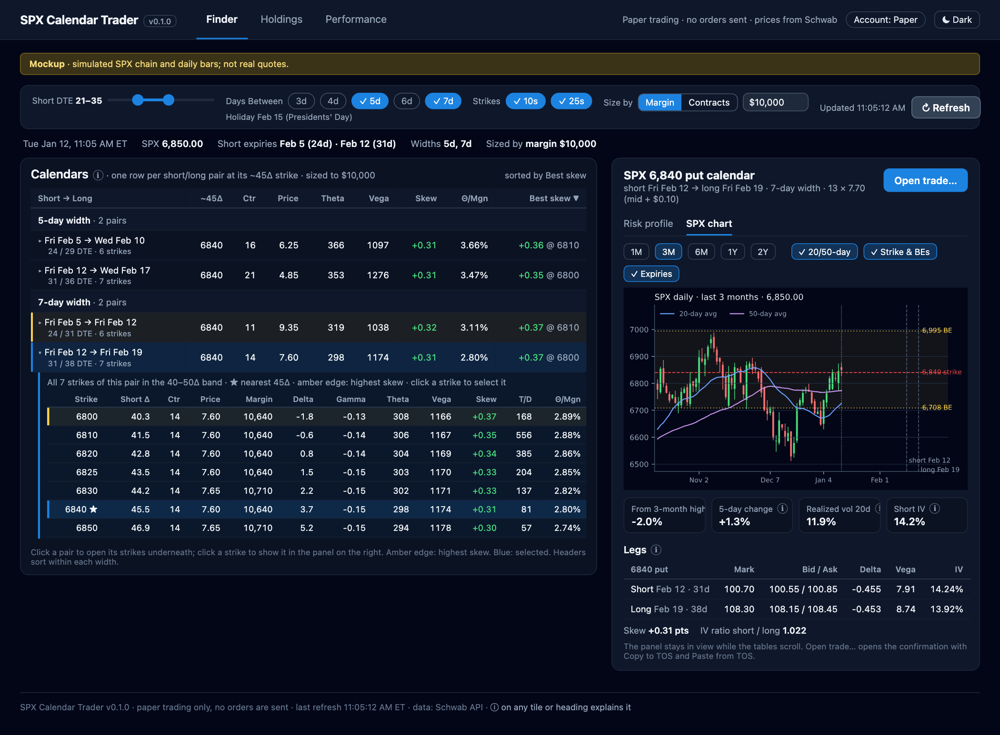
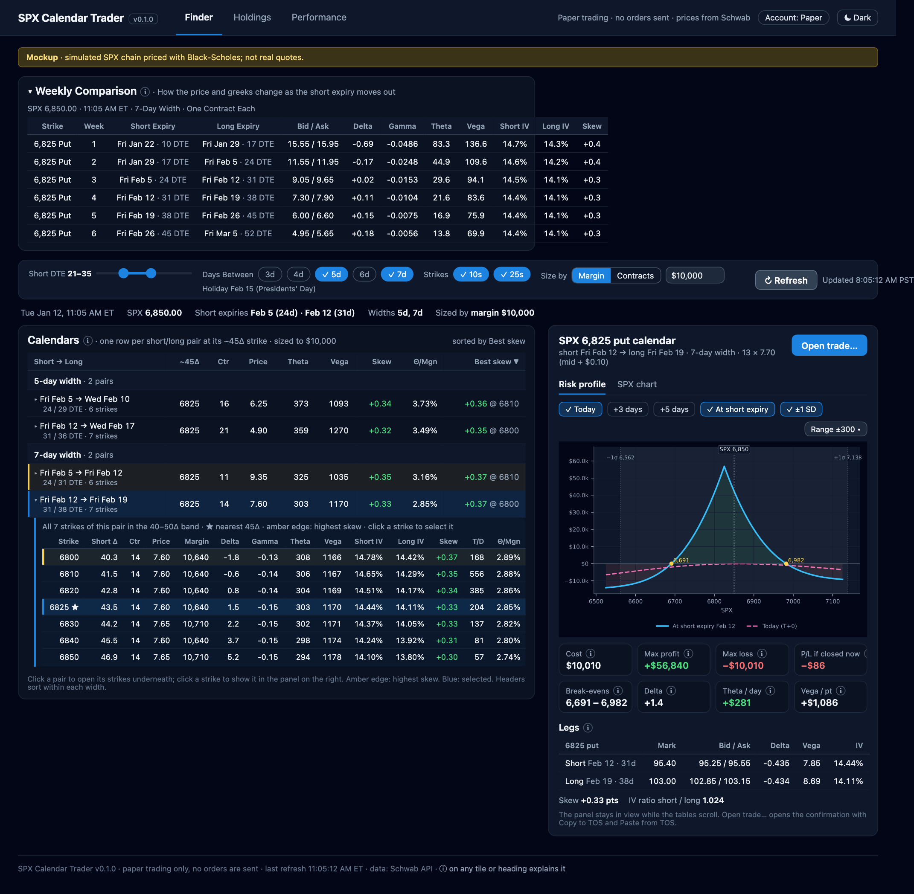

> **Disclaimer.** This is a research and paper-trading tool, not financial advice. Options trading carries substantial risk. The app never places orders: the Copy to TOS buttons only copy an order line to your clipboard, and anything you do with it in thinkorswim is your own decision.

# SPX Calendar Trader

A web app for finding and paper-trading ~45Δ SPX put calendars, using live option chains from the Schwab API. **No real orders are sent.** Built with FastAPI, Jinja templates, HTMX and a little vanilla JavaScript: no frontend framework and no build step; it runs on your own computer.

**Status:** under construction. Release 1, the core (find, open, track, close, results), is a 6-week build, Nov 24, 2026 – Jan 4, 2027; Release 2 adds the extras by Jan 18, 2027 (see the [build plan](docs/PLAN.md#6-week-build-plan)). An interactive Analyzer (a thinkorswim-style position modeler) and optional hosting on Railway come later, in Application Phase 2 ([plan](docs/PLAN.md#application-phase-2-after-release-2)).

**Progress so far**

| Week | What | State |
|---|---|---|
| 1 | • Schwab login and live option chains<br>• Calendar math (sizing, greeks, skew), checked against a reference sheet<br>• `cli candidates` prints today's calendars | Done |
| 2 | • The Finder page: filters, sortable pairs, strike rows, selected-calendar panel<br>• Auto-refresh when a filter changes<br>• Snapshots saved to `data/snapshots.json`<br>• Model gamma and delta (Schwab rounds them to 3 decimals) | Done |
| 3 | • [Open Trade](docs/WEEK3.md): live quote, suggested fill, Confirm saves the trade<br>• Copy to TOS and Paste from TOS<br>• Finder: 40–50Δ strikes, 45Δ target, auto-refresh every 60 s<br>• **Weekly Comparison** (puts, then calls, Strike Override)<br>• **SPX 10/20/50-day moving averages**<br>• **Risk Profile** tab (Today / At Short Expiry / ±1 SD)<br>• **ⓘ popovers** on tiles and filters | Built; Open Trade run-through and three real-quote trades are yours |
| 4–6 | • Holdings and closing trades (week 4)<br>• Performance (weeks 5–6) | Planned |

**Screens vs. the mockups.** The Finder in the running app follows the mockup below, with these differences: labels use Title Case; contracts are rounded to the nearest whole number (at least 1) instead of up; gamma and delta come from the model; and the filters refresh the table by themselves. The stability check in the Open Trade dialog tests each leg's bid-ask (at most 10% of that leg's price) rather than the whole calendar's, because the calendar's own bid-ask is the sum of both legs. The Finder lists 40–50Δ strikes with 45Δ as the target, and the screenshots show that. The Holdings, Close, Performance and TOS screens are still mockups.

**Contents:** [What it does](#what-it-does) · [Screenshots](#screenshots) · [Installation](#installation) · [Using VS Code](#using-vs-code) · [Project layout](#project-layout) · [Schwab API setup](#schwab-api-setup) · [Acknowledgments](#acknowledgments) · [License](#license)

## What it does

- **Finder:** 40–50Δ put calendars sized to $10,000 margin (or any amount, or a fixed number of contracts), with greeks and term-structure skew. Filters choose the short leg's DTE (1–8 weeks out; default ~30 days), the days between short and long (3–7; default 7) and which strikes to show (10s and/or 25s).
- **Weekly Comparison:** above the Finder settings (same width as the Calendars table), a separate table of the 7-day calendar at the starred row's strike (the star sits on the strike nearest 45Δ among multiples of 25, `config.STAR_STRIKE_MULTIPLE`), for the Friday nearest 7, 14, 21, 28, 35 and 42 DTE: price, bid/ask, delta, gamma, theta, vega, both IVs and the skew for one contract, to see how they change with time without setting the short expiry. A **Strike Override** box above it shows the strike in use (the starred row's until you type your own, to the nearest 5; Reset follows the star again). To its right, **SPX Moving Averages** shows the 10, 20 and 50-day simple averages of SPX daily closes (`config.SMA_DAYS`; Schwab price history, today's unfinished candle left out) and how far SPX is above or below each. The put rows come first, then, under a thicker line, the call calendars at the same strike. It fills in by itself and updates with every Finder refresh. The whole Finder page refreshes itself every `config.FINDER_REFRESH_S` seconds (60) while the tab is visible and no dialog is open, keeping your open pair, strike and sort.
- **Holdings:** open paper trades with P/L, break-evens, Vol P&L (how much of today's move came from volatility) and ±10% flags.
- **Performance:** results by month and week, and which entry conditions (skew, VIX, volatility at entry, short DTE, width, days held, day of week) made money.

Docs: [`docs/PLAN.md`](docs/PLAN.md) (scope and design) · [`docs/WEEK1.md`](docs/WEEK1.md) (this week's build steps) · [`CLAUDE.md`](CLAUDE.md) (coding rules) · [`CONTRIBUTING.md`](CONTRIBUTING.md) (how to contribute)

## Screenshots

Mockups of the planned screens, built from a simulated SPX chain priced with Black-Scholes. They are not real quotes, trades or results.

Every screen has a header with the Finder / Holdings / Performance tabs, the account and a light/dark theme toggle (dark by default), and every tile, heading and control has a small ⓘ that explains it.

**Finder:** filters on one line across the top, then two columns. On the left, one row per short/long pair at its ~45Δ strike, split by width and sortable (here by best skew); clicking a pair opens all its strikes underneath, with the highest skew marked in amber and the strike nearest 40Δ starred. On the right, a panel for the selected strike stays in view: a thinkorswim-style risk profile (P/L today and at the short expiry, profit and loss shading, the ±1 SD move and break-evens), tiles for cost, max profit and loss, break-evens and greeks, and both legs with their IVs, skew and IV ratio.


The panel's second tab shows a daily SPX chart (3 months by default) with the selected calendar's strike, break-evens and expiries drawn on:



The **Weekly Comparison** above the filters starts collapsed (the main screenshot) and remembers how you leave it; expanded it looks like this:



**Opening a trade:** the fill waits for a stable mid, then suggests mid + $0.10, which you can edit before confirming. **Copy to TOS** copies the order line to paste into thinkorswim.


**Holdings:** summary cards (SPX now, open trades, capital, open P/L, Vol P&L today), then the open trades with P/L, break-evens, Vol P&L, skew and flags. A toolbar has **＋ Open trade** (for a trade placed in thinkorswim) and **▦ Columns** to choose which columns show; the table scrolls sideways with the trade pinned on the left, and the Closed list sits under it. The selected trade gets its own panel on the right: **Close trade…**, **✎ Notes** and **⧉ Copy closing order**, its risk profile with P/L now, tiles, and its notes.


**Closing a trade:** the exit price waits for a stable mid, then suggests mid − $0.10, with P/L, days held and the closing order to copy.


**Paste from TOS:** below Copy to TOS in both dialogs. Paste the order from thinkorswim and the dialog takes its price and contracts, so the app records what you actually got; a trade placed straight in thinkorswim can be entered this way too. See the [mockup and rules](docs/PLAN.md#screen-2--holdings).

**Performance:** results from closed trades, split into sub-tabs (Summary, By period, By condition, Exits, Trades) and filterable by period. Each tab is described, with its own screenshot, in [docs/PERFORMANCE.md](docs/PERFORMANCE.md).


The images are generated by code in [`docs/mockups/`](docs/mockups/README.md). To suggest a screen change, edit it there, regenerate, and open a pull request.

## Installation

### Prerequisites

| Tool | Needed for | Required? |
| --- | --- | --- |
| [Git](https://git-scm.com) | cloning and version control | Yes |
| [uv](https://docs.astral.sh/uv/) | installs Python 3.12 and every package | Yes |
| [Schwab developer app](#schwab-api-setup) | live SPX option chains (not needed for the tests) | Yes, to use live data |
| [VS Code](https://code.visualstudio.com) | editor | Recommended |
| [Node.js 18+](https://nodejs.org) | running the JavaScript tests only (`node --test`); the app doesn't need it | Optional |
| [SQLite command-line tool](https://sqlite.org/download.html) (`sqlite3`) | looking inside `data/paper_trades.db` by hand; the app itself does not need it | Optional |

You don't need to install Python yourself: uv reads `.python-version` and fetches 3.12. The database is SQLite, which is built into Python, so there is nothing to install or set up for the app: it creates `data/paper_trades.db` the first time it starts.

**Install commands**

macOS:

```bash
xcode-select --install          # Git
brew install uv                 # or: curl -LsSf https://astral.sh/uv/install.sh | sh
brew install node               # optional
# sqlite3 (optional) is already on macOS
```

Linux:

```bash
curl -LsSf https://astral.sh/uv/install.sh | sh
sudo apt install sqlite3        # optional; Fedora: sudo dnf install sqlite
```

Windows (PowerShell):

```powershell
powershell -c "irm https://astral.sh/uv/install.ps1 | iex"
```

On Windows, install Git from <https://git-scm.com>. For the optional `sqlite3`: `winget install SQLite.SQLite`, or download the "sqlite-tools" zip from <https://sqlite.org/download.html>.

### Clone and install

```bash
git clone https://github.com/lavjain/SPXCalendarTrader.git
cd SPXCalendarTrader
uv sync                 # creates .venv/ with Python 3.12 and all dependencies
```

### Check it works

```bash
uv run python -m app.core.calendar_math selftest          # expect "16/16 rows reproduce exactly."
mkdir -p data && uv run python -m app.core.schwab_api chain --demo \
    --out data/demo_chain.csv --smile data/demo_smile.csv  # parses a built-in sample chain, no network
```

### Look inside the database (optional)

After you have opened a paper trade (or pressed Refresh), this prints your trades and the Finder rows saved by Refresh:

```bash
sqlite3 -header -column data/paper_trades.db \
  "select id, status, strike, contracts, open_fill, open_price_source, opened_at from trades;"
sqlite3 data/paper_trades.db "select count(*) from finder_log;"
```

Without the command-line tool: `uv run python -c "import sqlite3; print(sqlite3.connect('data/paper_trades.db').execute('select * from trades').fetchall())"`. Close the app first if you want to edit anything; reading while it runs is fine.

### Run

One-time setup (do these once, in order):

```bash
cp .env.example .env            # then open .env and add SCHWAB_APP_KEY and SCHWAB_APP_SECRET (see Schwab API setup)
uv sync                         # installs everything, including the web server
```

Every week, log in to Schwab (the token lasts seven days):

```bash
uv run --env-file .env python -m app.core.schwab_api auth
```

**Start the app** (the Finder screen):

```bash
uv run serve
```

Then open <http://localhost:8000>. It starts on the Finder: set the filters, press **↻ Refresh** (changing a filter refreshes by itself after a short pause), click a pair to open its strikes, click a strike to see its calendar. Stop it with `Ctrl+C`. `uv run serve` reloads when you edit files under `app/` and reads your keys from `.env` itself. The API is documented at <http://localhost:8000/docs>.

**Shortcut:** the `./spxcal` script in the repo root runs all of the commands below without the long prefix (run it from the repo folder; the first time, `chmod +x spxcal` if it says permission denied):

```bash
./spxcal candidates                 # same as: uv run --env-file .env python -m cli candidates
./spxcal candidates --widths 5 7 --size-value 15000
./spxcal diagnose --tos 6871.92 7415.05
./spxcal serve                      # starts the web app
./spxcal auth                       # weekly Schwab login
./spxcal test                       # Python and JavaScript tests
./spxcal help                       # list of shortcuts, then the CLI help
```

To type just `spxcal` from anywhere, add `alias spxcal="$HOME/dev/SPXCalendarTrader/spxcal"` to `~/.zshrc` (adjust the path to where you cloned the repo), then open a new terminal.

**Terminal version** (no browser; prints today's 40–50Δ put calendars with break-evens), useful to compare against the page:

```bash
uv run --env-file .env python -m cli candidates
```

Options (all optional; the defaults below are the Finder's defaults, from `app/core/config.py`):

| Option | Default | Meaning |
|---|---|---|
| `--dte-min` / `--dte-max` | 25 / 35 | short-leg DTE range |
| `--widths` | 7 | days between short and long expiry (any of 3 4 5 6 7) |
| `--strike-sets` | 10 25 | strike spacing: 10 = 10s plus 25/75, 25 = 25s |
| `--size-mode` | margin | `margin`: contracts = target margin ÷ debit; `contracts`: a fixed count |
| `--size-value` | 10000 | target margin in dollars, or the number of contracts |

Contracts are rounded to the **nearest** whole contract (at least 1), so margin lands within half a contract of the target, above or below it. Change `SIZE_ROUNDING` in `app/core/config.py` to `"ceil"` (never under the target, the original spreadsheet rule) or `"floor"` (never over).

Help, with every option and its default, is built in:

```bash
uv run --env-file .env python -m cli --help               # the commands and examples
uv run --env-file .env python -m cli candidates --help    # every option of candidates, with defaults
uv run --env-file .env python -m cli diagnose --help
```

Examples:

```bash
uv run --env-file .env python -m cli candidates --dte-min 20 --dte-max 40 --widths 5 7
uv run --env-file .env python -m cli candidates --size-mode contracts --size-value 2
uv run --env-file .env python -m cli diagnose --tos 6871.92 7415.05   # why break-evens differ from thinkorswim
```

**Tests:**

```bash
uv run pytest                           # Python tests
node --test tests/js/*.test.mjs         # JavaScript tests (needs Node 18+)
```

For other commands, `--env-file .env` loads the keys; to skip typing it, run `export UV_ENV_FILE=.env` in your shell (or add it to your shell profile).

**Where your data goes** (all under `data/`, which is gitignored and never leaves your machine): `paper_trades.db` holds settings and the Finder log (and paper trades from week 3); `snapshots.json` holds the last 20 Finder refreshes, so a restart reopens on the last one. Delete `snapshots.json` any time to clear it.

## Using VS Code

### Open the project

- **Clone from VS Code:** Command Palette (`Cmd/Ctrl+Shift+P`) → **Git: Clone** → paste `https://github.com/lavjain/SPXCalendarTrader.git` → choose a folder → **Open**.
- **Or** open a folder you already cloned: **File → Open Folder…**.

Then, in VS Code's terminal (`` Ctrl+` ``), run `uv sync`.

### First-time setup

1. **Install the recommended extensions.** VS Code prompts you on first open (they're listed in `.vscode/extensions.json`): Python, Python Debugger, Claude Code, GitHub Pull Requests, Even Better TOML. If you missed the prompt: Extensions panel → filter `@recommended`.
2. **Select the interpreter.** It should pick `.venv` automatically. If not: Command Palette → **Python: Select Interpreter** → `./.venv/bin/python` (Windows: `.venv\Scripts\python.exe`).
3. **Add your Schwab keys** to `.env` (copy from `.env.example`). The Run and Debug configurations read it automatically, and the shared settings turn on `python.terminal.useEnvFile`, so VS Code's terminal loads it too (open a new terminal after editing `.env`). Outside VS Code, use `uv run --env-file .env …` as above.
4. **Sign in to GitHub** (Accounts icon, bottom left) so you can push and review pull requests from VS Code.

### Everyday use

| Task | In VS Code |
| --- | --- |
| Run tests | **Testing** panel (flask icon) → Run All; or `uv run pytest` in the terminal |
| Run or debug the app | `uv run serve` in the terminal; or **Run and Debug** panel → **App** → F5 (from week 2) |
| Run the self-test / demo pull | **Run and Debug** → **Self-test (calendar_math)** or **Schwab demo pull** |
| Create a branch | click the branch name (bottom left) → **Create new branch…** |
| Commit and push | **Source Control** panel → stage → message → **Commit** → **Sync Changes** |
| Open or review a pull request | **GitHub Pull Requests** panel → create, comment, check out a PR's branch |
| Work with Claude Code | Claude Code panel. It reads `CLAUDE.md` automatically. Give it one step from `docs/WEEK1.md` at a time |

Add packages with `uv add <package>` (never `pip install`), then commit both `pyproject.toml` and `uv.lock`. After pulling someone else's changes, run `uv sync`.

## Project layout

```
app/
  main.py           # FastAPI app (uv run serve)
  settings.py       # keys, paths and feature flags from environment variables
  pages.py          # the Finder, Holdings and Performance pages
  partials.py       # HTMX fragments: tables, cards, dialogs
  schemas.py        # API request/response models
  api/              # JSON endpoints under /api (documented at /docs)
  info_text.py      # the words behind every ⓘ popover (one place to edit them)
  core/             # all trading logic, plain Python
    config.py       # every tunable number (margin, offsets, thresholds, polling, rate limits)
    models.py       # Pydantic inputs/outputs
    services.py     # one function per endpoint
    schwab_api.py   # Schwab OAuth, weekly token, chain and quote pulls
    calendar_math.py# calendar sizing, greeks, skew (+ self-test)
    expiries.py     # short Fridays, long dates, holidays
    stability.py    # is the quoted calendar price steady? (switched off for now)
    tos.py          # write and read thinkorswim calendar order lines (Copy / Paste)
    pricing.py      # Black-Scholes, P/L curves, break-evens
    store.py        # SQLite: trades, finder_log, settings (marks and spx_daily come later)
  templates/        # Jinja: base.html, header, footer, one page per screen, partials/
  static/           # js/ (one controller per page, charts), css/
cli.py              # week 1: prints today's candidates from the terminal
tests/              # pytest; tests/js/ for node --test
docs/               # PLAN.md, WEEK1.md, images/ (screenshots), mockups/ (code that draws them)
data/               # local database and logs (gitignored)
```

Files marked by week in `docs/PLAN.md` appear as they're built.

## Schwab API setup

1. Register a **developer account** at <https://developer.schwab.com>. This is a separate login from the brokerage account.
2. Dashboard → Create App. Select **both** API products; option chains are on the Market Data side, not Accounts and Trading.
3. Callback URL `https://127.0.0.1:8182`. Use the **Add Another** button for a second entry; never comma-separate two URLs in one field, which produces an app that reads "Ready for Use" and then fails at login.
4. Wait for status **Approved - Pending** → **Ready for Use** (1–3 business days). Keys are visible before approval but will not authenticate.
5. Dashboard → app → **View Details**. Copy the App Key and App Secret from the bottom of the page, watching for trailing whitespace.

Put them in `.env` (gitignored). Commands read it through `uv run --env-file .env` (see [Run](#run)); VS Code's Run and Debug configurations read it automatically:

```bash
cp .env.example .env    # then fill in SCHWAB_APP_KEY and SCHWAB_APP_SECRET
```

Or export them in your shell:

```bash
export SCHWAB_APP_KEY='...'
export SCHWAB_APP_SECRET='...'
export SCHWAB_CALLBACK_URL='https://127.0.0.1:8182'
```

The OAuth token is written to `~/.schwab/calendar_skew_token.json` (mode 600), **outside the repository**. Override with `SCHWAB_TOKEN_PATH`. Never commit keys or tokens.

### The seven-day re-login

Schwab expires refresh tokens after 7 days with no way to extend. Access tokens last 30 minutes and refresh automatically.

```bash
uv run --env-file .env python -m app.core.schwab_api auth    # every Sunday before the open
```

`schwab_api.py` checks the login's age before every pull and raises a clear error rather than silently returning nothing; the app shows it at the top of the page.

Auth flows: `--flow manual` (default, no server: paste the URL from the browser's address bar), `--flow listen` (temporary HTTPS listener on 8182; the browser will warn about the self-signed certificate, proceed anyway), `--flow schwabpy` (needs `uv add schwab-py`, and writes a token format this script doesn't read, so it's only useful with schwab-py's own client). Log in with **brokerage** credentials, not developer-portal ones.

### Verified against the live API

Confirmed against a real `$SPX` pull (2026-08-17):

1. **Symbol format:** `$SPX` works as-is.
2. **Field names:** `strategy=SINGLE` returns `volatility`, `delta`, `gamma`, `theta`, `vega` per contract as `parse()` expects.
3. **Greek scaling:** greeks arrive **per share**, not ×100. This is what `calendar_math.py` expects.
4. **`volatility` can be garbage on worthless contracts:** deep OTM/ITM contracts with near-zero bid/ask can return IV in the thousands of percent. The 40–50Δ band filter (week 1) will skip them, but any code that iterates all contracts should also filter on a plausible IV range.
5. **`theoreticalVolatility` is not usable:** it comes back as a flat constant across strikes and expiries. Use `volatility`.
6. **"Body buffer overflow" 502:** an unbounded chain request is too large. `get_chain()` always sends `fromDate`/`toDate` and `range=OTM` to keep the payload small.

### Troubleshooting

| Symptom | Cause |
|---|---|
| `invalid_grant` at auth | authorization code not URL-decoded, or callback string doesn't match the portal exactly |
| "We are unable to complete your request" | whitespace in key/secret, or two callback URLs comma-separated in one field |
| 401 on a chain call | app status still "Approved - Pending" |
| refresh fails after a week | expected; re-run the weekly `auth` command |
| `--flow listen` permission error | callback has no port, so it defaults to 443; register a port above 1024 |
| browser certificate warning | expected with `--flow listen`; self-signed cert |
| 429 | rate limit; the app backs off and retries on its own (it stays under about 100 requests a minute) |

## Acknowledgments

Thank you to **Tom Conley** for inspiring this project. His walkthrough of how he trades 7-day-wide SPX put calendars (June 2, 2026), and how he tracks each leg's implied volatility day to day, shaped the trade this app paper-trades.

Thank you to **Lane Snell** (Sheridan Mentoring), whose SPX calendar spreadsheet is the source of the calendar metrics in `calendar_math.py` (contract sizing, Skew, T/D, Θ/Mgn). The module's self-test reproduces his 2021-09-17 SPX sheet row for row.

## License

Apache License 2.0. See [LICENSE](LICENSE).

Not affiliated with or endorsed by Charles Schwab. Schwab and thinkorswim are trademarks of Charles Schwab & Co., Inc.
