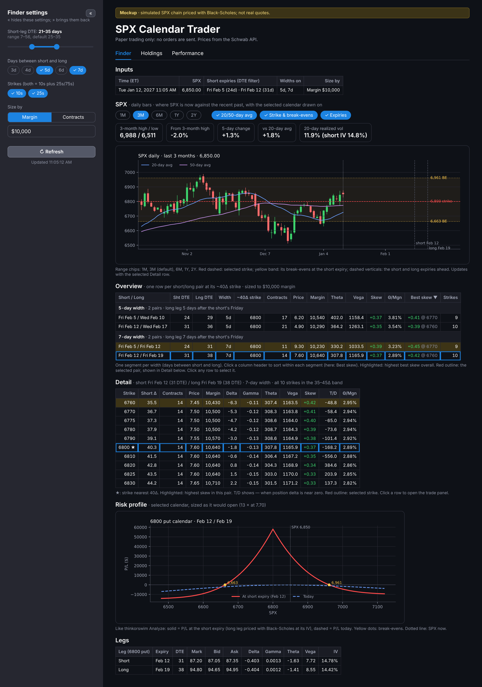
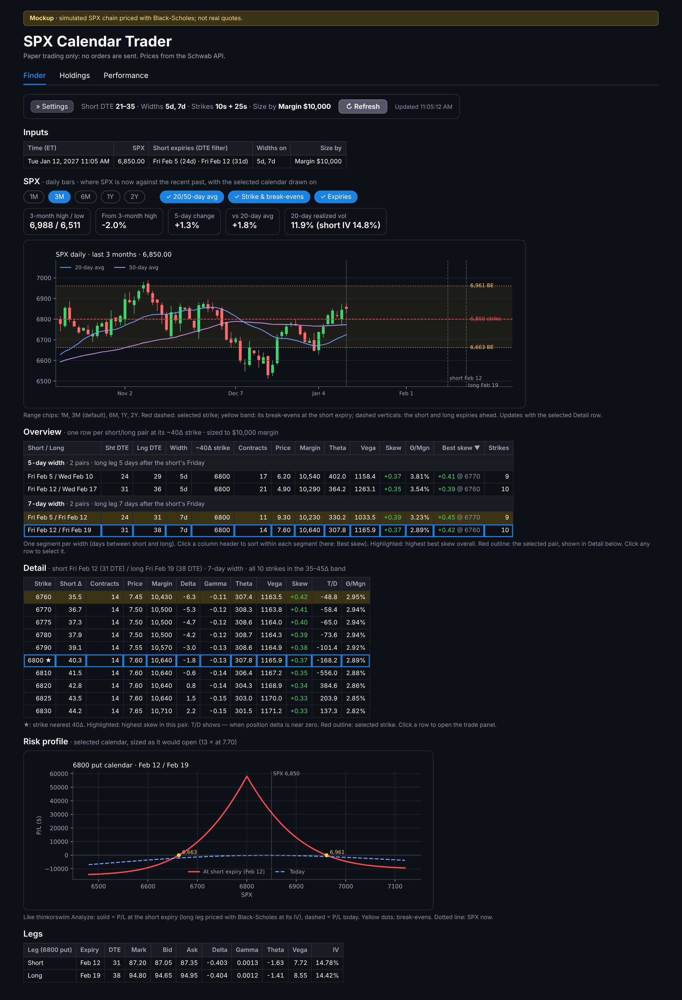
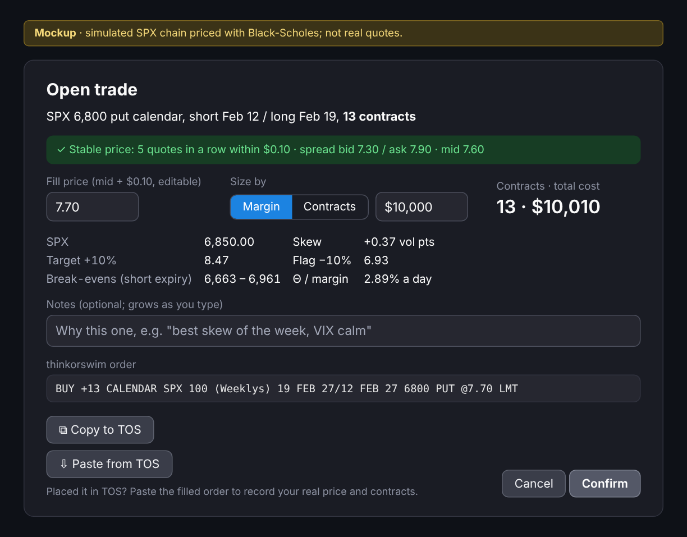
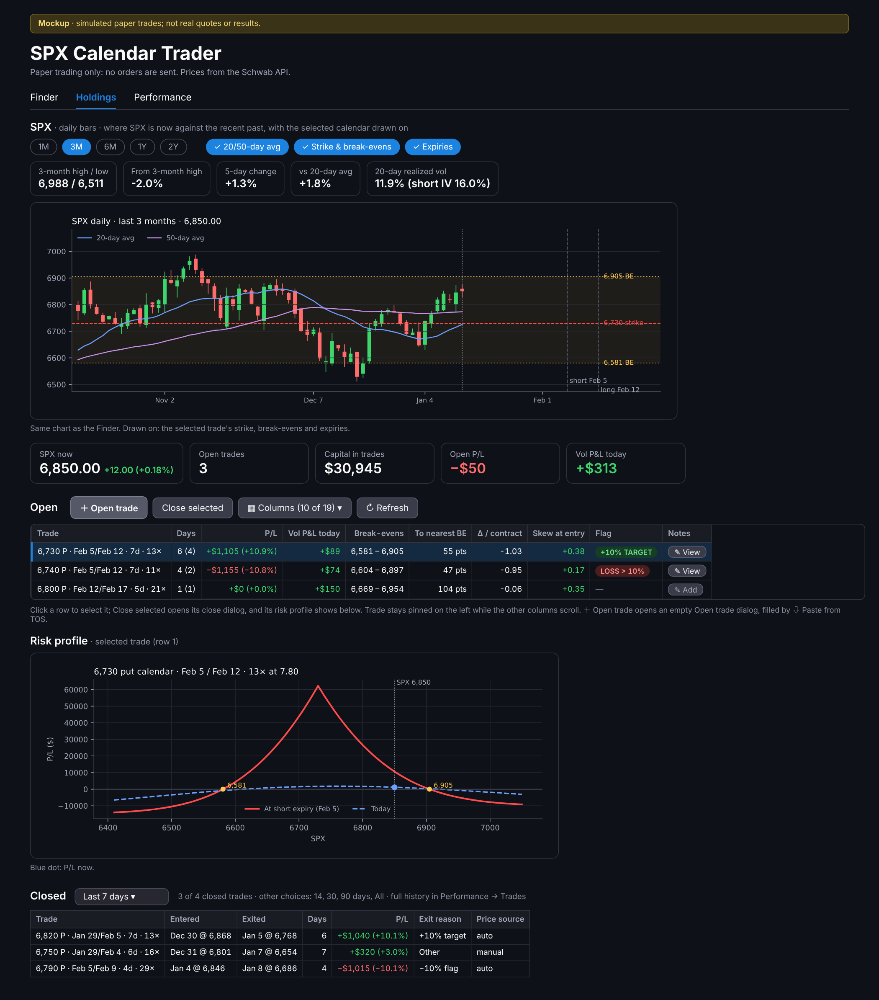
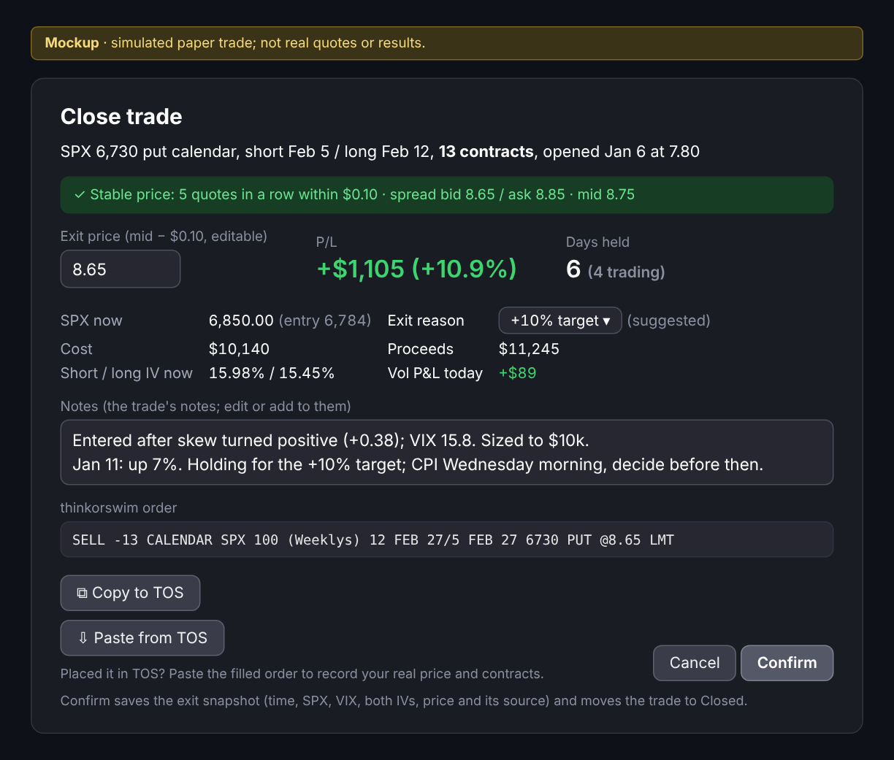
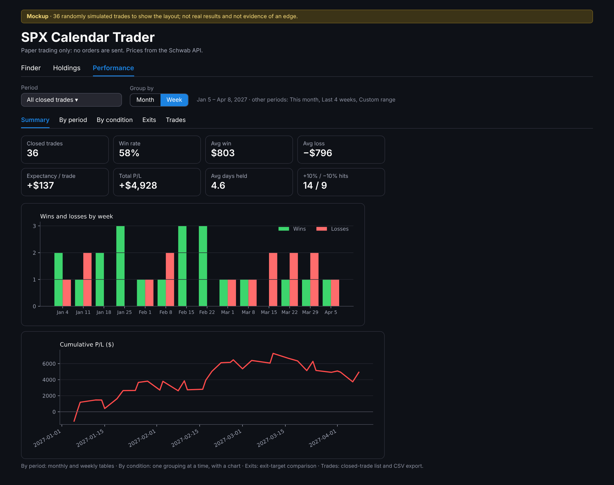

# SPX Calendar Trader

A Streamlit app for finding and paper-trading ~40Δ SPX put calendars, using live option chains from the Schwab API. **No real orders are sent.**

> **Disclaimer.** This is a research and paper-trading tool, not financial advice. Options trading carries substantial risk. The app never places orders: the Copy to TOS buttons only copy an order line to your clipboard, and anything you do with it in thinkorswim is your own decision.

**Status:** under construction. Release 1, the core (find, open, track, close, results), is a 6-week build, Nov 24, 2026 – Jan 4, 2027; Release 2 adds the extras by Jan 18, 2027 (see the [build plan](docs/PLAN.md#6-week-build-plan)). The screens below are mockups of both releases; the Streamlit app arrives in week 2.

**Contents:** [What it does](#what-it-does) · [Screenshots](#screenshots) · [Installation](#installation) · [Using VS Code](#using-vs-code) · [Project layout](#project-layout) · [Schwab API setup](#schwab-api-setup) · [Acknowledgments](#acknowledgments) · [License](#license)

## What it does

- **Finder:** 35–45Δ put calendars sized to $10,000 margin (or any amount, or a fixed number of contracts), with greeks and term-structure skew. Filters choose the short leg's DTE (1–8 weeks out; default ~30 days), the days between short and long (3–7; default 7) and which strikes to show (10s and/or 25s).
- **Holdings:** open paper trades with P/L, break-evens, Vol P&L (how much of today's move came from volatility) and ±10% flags.
- **Performance:** results by month and week, and which entry conditions (skew, VIX, volatility at entry, short DTE, width, days held, day of week) made money.

Docs: [`docs/PLAN.md`](docs/PLAN.md) (scope and design) · [`docs/WEEK1.md`](docs/WEEK1.md) (this week's build steps) · [`CLAUDE.md`](CLAUDE.md) (coding rules) · [`CONTRIBUTING.md`](CONTRIBUTING.md) (how to contribute)

## Screenshots

Mockups of the planned screens, built from a simulated SPX chain priced with Black-Scholes. They are not real quotes, trades or results.

**Finder:** settings in a collapsible sidebar, one per line; a daily SPX chart (3 months by default) with the selected calendar's strike, break-evens and expiries drawn on; an Overview with one row per short/long pair at its ~40Δ strike, split by width and sortable (here by best skew); and a Detail table with every strike of the selected pair, the highest-skew row highlighted and the strike nearest 40Δ starred.



With the settings sidebar collapsed, a one-line bar shows the applied settings and keeps Refresh at hand:



**Opening a trade:** the fill waits for a stable mid, then suggests mid + $0.10, which you can edit before confirming. **Copy to TOS** copies the order line to paste into thinkorswim.



**Holdings:** the SPX chart on top, SPX now in the summary row, then open trades with P/L, break-evens, Vol P&L, skew, flags and a ✎ View button for each trade's notes (also shown in the open and close dialogs). A toolbar has **＋ Open trade** (for a trade placed in thinkorswim), **Close selected**, and **▦ Columns** to choose which columns show; the table scrolls sideways with the trade pinned on the left. Below the table, the selected trade's **risk profile**: a thinkorswim-style P/L chart (today and at the short expiry) with break-evens and P/L now. The Finder shows the same chart for the selected strike.



**Closing a trade:** the exit price waits for a stable mid, then suggests mid − $0.10, with P/L, days held and the closing order to copy.



**Paste from TOS:** below Copy to TOS in both dialogs. Paste the order from thinkorswim and the dialog takes its price and contracts, so the app records what you actually got; a trade placed straight in thinkorswim can be entered this way too. See the [mockup and rules](docs/PLAN.md#screen-2--holdings).

**Performance:** results from closed trades, split into sub-tabs (Summary, By period, By condition, Exits, Trades) and filterable by period. Each tab is described, with its own screenshot, in [docs/PERFORMANCE.md](docs/PERFORMANCE.md).



The images are generated by code in [`docs/mockups/`](docs/mockups/README.md). To suggest a screen change, edit it there, regenerate, and open a pull request.

## Installation

### Prerequisites

| Tool | Why | Install |
| --- | --- | --- |
| Git | version control | macOS: `xcode-select --install` · Windows: <https://git-scm.com> |
| uv | installs Python 3.12 and all packages | macOS/Linux: `curl -LsSf https://astral.sh/uv/install.sh \| sh` (or `brew install uv`) · Windows: `powershell -c "irm https://astral.sh/uv/install.ps1 \| iex"` |
| VS Code | editor (recommended) | <https://code.visualstudio.com> |
| Schwab developer app | live option chains | see [Schwab API setup](#schwab-api-setup); not needed for tests |

You don't need to install Python yourself: uv reads `.python-version` and fetches 3.12.

### Clone and install

```bash
git clone https://github.com/lavjain/SPXCalendarTrader.git
cd SPXCalendarTrader
uv sync                 # creates .venv/ with Python 3.12 and all dependencies
```

### Check it works

```bash
uv run python calendar_math.py selftest                    # expect "16/16 rows reproduce exactly."
mkdir -p data && uv run python schwab_api.py chain --demo \
    --out data/demo_chain.csv --smile data/demo_smile.csv  # parses a built-in sample chain, no network
uv run pytest                                              # "no tests ran" until week 1 adds the first tests
```

### Run

```bash
cp .env.example .env                              # once; then add your Schwab keys (see Schwab API setup)
uv run --env-file .env python schwab_api.py auth  # once a week
uv run --env-file .env app.py                     # from week 2; opens http://localhost:8501
```

`--env-file .env` loads your Schwab keys for that command. To skip typing it, run `export UV_ENV_FILE=.env` in your shell (or add it to your shell profile).

Paper trades are stored in `data/paper_trades.db`, which never leaves your machine (gitignored).

## Using VS Code

### Open the project

- **Clone from VS Code:** Command Palette (`Cmd/Ctrl+Shift+P`) → **Git: Clone** → paste `https://github.com/lavjain/SPXCalendarTrader.git` → choose a folder → **Open**.
- **Or** open a folder you already cloned: **File → Open Folder…**.

Then, in VS Code's terminal (`` Ctrl+` ``), run `uv sync`.

### First-time setup

1. **Install the recommended extensions.** VS Code prompts you on first open (they're listed in `.vscode/extensions.json`): Python, Python Debugger, Claude Code, GitHub Pull Requests, Even Better TOML. If you missed the prompt: Extensions panel → filter `@recommended`.
2. **Select the interpreter.** It should pick `.venv` automatically. If not: Command Palette → **Python: Select Interpreter** → `./.venv/bin/python` (Windows: `.venv\Scripts\python.exe`).
3. **Add your Schwab keys** to `.env` (copy from `.env.example`). The Run and Debug configurations read it automatically, and the shared settings turn on `python.terminal.useEnvFile`, so VS Code's terminal loads it too (open a new terminal after editing `.env`). Outside VS Code, use `uv run --env-file .env …` as above.
4. **Sign in to GitHub** (Accounts icon, bottom left) so you can push and review pull requests from VS Code.

### Everyday use

| Task | In VS Code |
| --- | --- |
| Run tests | **Testing** panel (flask icon) → Run All; or `uv run pytest` in the terminal |
| Run or debug the app | **Run and Debug** panel → **Streamlit app** → F5 |
| Run the self-test / demo pull | **Run and Debug** → **Self-test (calendar_math)** or **Schwab demo pull** |
| Create a branch | click the branch name (bottom left) → **Create new branch…** |
| Commit and push | **Source Control** panel → stage → message → **Commit** → **Sync Changes** |
| Open or review a pull request | **GitHub Pull Requests** panel → create, comment, check out a PR's branch |
| Work with Claude Code | Claude Code panel. It reads `CLAUDE.md` automatically. Give it one step from `docs/WEEK1.md` at a time |

Add packages with `uv add <package>` (never `pip install`), then commit both `pyproject.toml` and `uv.lock`. After pulling someone else's changes, run `uv sync`.

## Project layout

```
app.py              # Streamlit UI (week 2): the only file that imports streamlit
services.py         # one function per future API endpoint
models.py           # Pydantic inputs/outputs
settings.py         # every tunable number (margin, offsets, thresholds)
schwab_api.py       # Schwab OAuth, weekly token, chain pull
calendar_math.py    # calendar sizing, greeks, skew (+ self-test)
cli.py              # week 1: prints today's candidates from the terminal
pricing.py          # Black-Scholes, P/L curves, break-evens
charts.py           # Plotly figures (risk profile)
store.py            # SQLite: trades, marks, finder_log
tests/              # pytest
docs/               # PLAN.md, WEEK1.md, images/ (screenshots), mockups/ (code that draws them)
data/               # local database and logs (gitignored)
```

Files marked by week in `docs/PLAN.md` appear as they're built.

## Schwab API setup

1. Register a **developer account** at <https://developer.schwab.com>. This is a separate login from the brokerage account.
2. Dashboard → Create App. Select **both** API products; option chains are on the Market Data side, not Accounts and Trading.
3. Callback URL `https://127.0.0.1:8182`. Use the **Add Another** button for a second entry; never comma-separate two URLs in one field, which produces an app that reads "Ready for Use" and then fails at login.
4. Wait for status **Approved - Pending** → **Ready for Use** (1–3 business days). Keys are visible before approval but will not authenticate.
5. Dashboard → app → **View Details**. Copy the App Key and App Secret from the bottom of the page, watching for trailing whitespace.

Put them in `.env` (gitignored). Commands read it through `uv run --env-file .env` (see [Run](#run)); VS Code's Run and Debug configurations read it automatically:

```bash
cp .env.example .env    # then fill in SCHWAB_APP_KEY and SCHWAB_APP_SECRET
```

Or export them in your shell:

```bash
export SCHWAB_APP_KEY='...'
export SCHWAB_APP_SECRET='...'
export SCHWAB_CALLBACK_URL='https://127.0.0.1:8182'
```

The OAuth token is written to `~/.schwab/calendar_skew_token.json` (mode 600), **outside the repository**. Override with `SCHWAB_TOKEN_PATH`. Never commit keys or tokens.

### The seven-day re-login

Schwab expires refresh tokens after 7 days with no way to extend. Access tokens last 30 minutes and refresh automatically.

```bash
uv run --env-file .env python schwab_api.py auth    # every Sunday before the open
```

`schwab_api.py` checks token age before every pull and exits with a clear message rather than silently returning nothing.

Auth flows: `--flow manual` (default, no server: paste the URL from the browser's address bar), `--flow listen` (temporary HTTPS listener on 8182; the browser will warn about the self-signed certificate, proceed anyway), `--flow schwabpy` (needs `uv add schwab-py`, and writes a token format this script doesn't read, so it's only useful with schwab-py's own client). Log in with **brokerage** credentials, not developer-portal ones.

### Verified against the live API

Confirmed against a real `$SPX` pull (2026-08-17):

1. **Symbol format:** `$SPX` works as-is.
2. **Field names:** `strategy=SINGLE` returns `volatility`, `delta`, `gamma`, `theta`, `vega` per contract as `parse()` expects.
3. **Greek scaling:** greeks arrive **per share**, not ×100. This is what `calendar_math.py` expects.
4. **`volatility` can be garbage on worthless contracts:** deep OTM/ITM contracts with near-zero bid/ask can return IV in the thousands of percent. The 35–45Δ band filter (week 1) will skip them, but any code that iterates all contracts should also filter on a plausible IV range.
5. **`theoreticalVolatility` is not usable:** it comes back as a flat constant across strikes and expiries. Use `volatility`.
6. **"Body buffer overflow" 502:** an unbounded chain request is too large. `get_chain()` always sends `fromDate`/`toDate` and `range=OTM` to keep the payload small.

### Troubleshooting

| Symptom | Cause |
|---|---|
| `invalid_grant` at auth | authorization code not URL-decoded, or callback string doesn't match the portal exactly |
| "We are unable to complete your request" | whitespace in key/secret, or two callback URLs comma-separated in one field |
| 401 on a chain call | app status still "Approved - Pending" |
| refresh fails after a week | expected; re-run `schwab_api.py auth` |
| `--flow listen` permission error | callback has no port, so it defaults to 443; register a port above 1024 |
| browser certificate warning | expected with `--flow listen`; self-signed cert |
| 429 | rate limit; back off 60 seconds |

## Acknowledgments

Thank you to **Tom Conley** for inspiring this project. His walkthrough of how he trades 7-day-wide SPX put calendars (June 2, 2026), and how he tracks each leg's implied volatility day to day, shaped the trade this app paper-trades.

Thank you to **Lane Snell** (Sheridan Mentoring), whose SPX calendar spreadsheet is the source of the calendar metrics in `calendar_math.py` (contract sizing, Skew, T/D, Θ/Mgn). The module's self-test reproduces his 2021-09-17 SPX sheet row for row.

## License

Apache License 2.0. See [LICENSE](LICENSE).

Not affiliated with or endorsed by Charles Schwab. Schwab and thinkorswim are trademarks of Charles Schwab & Co., Inc.
