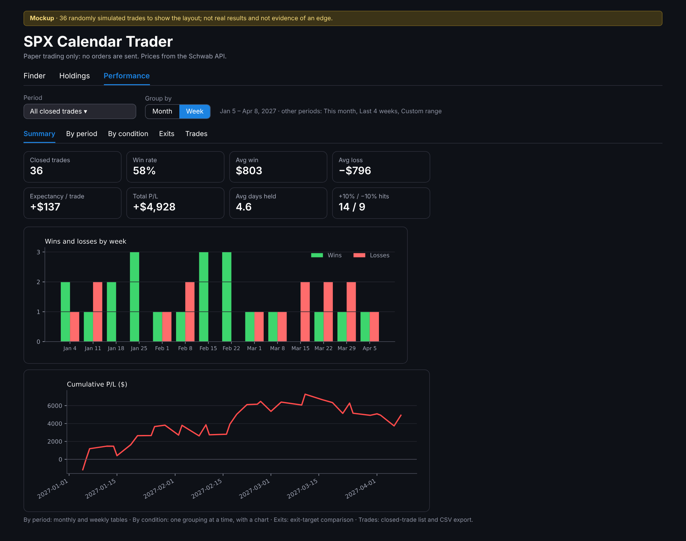
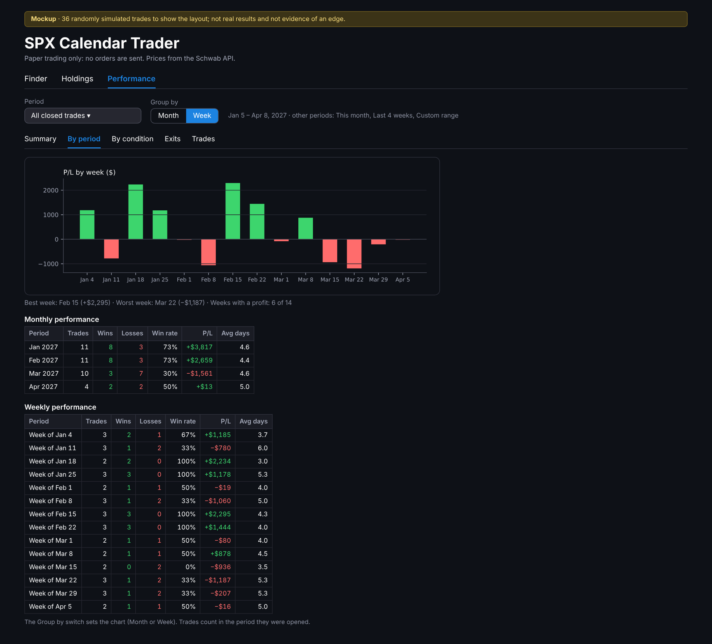
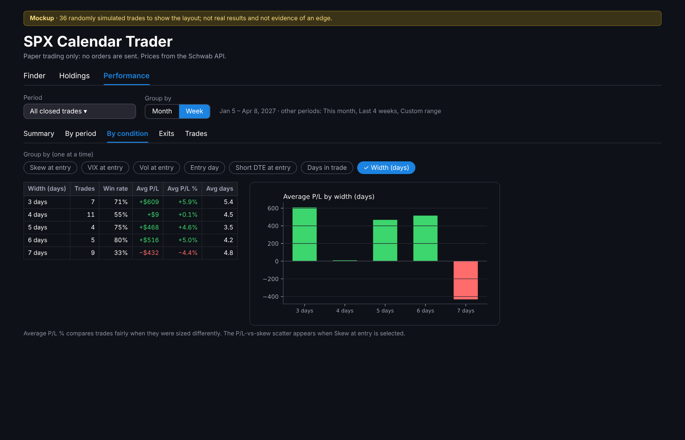
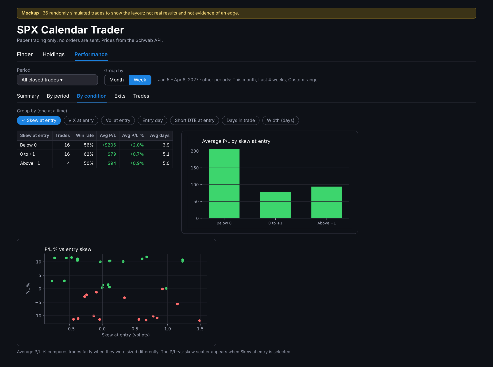
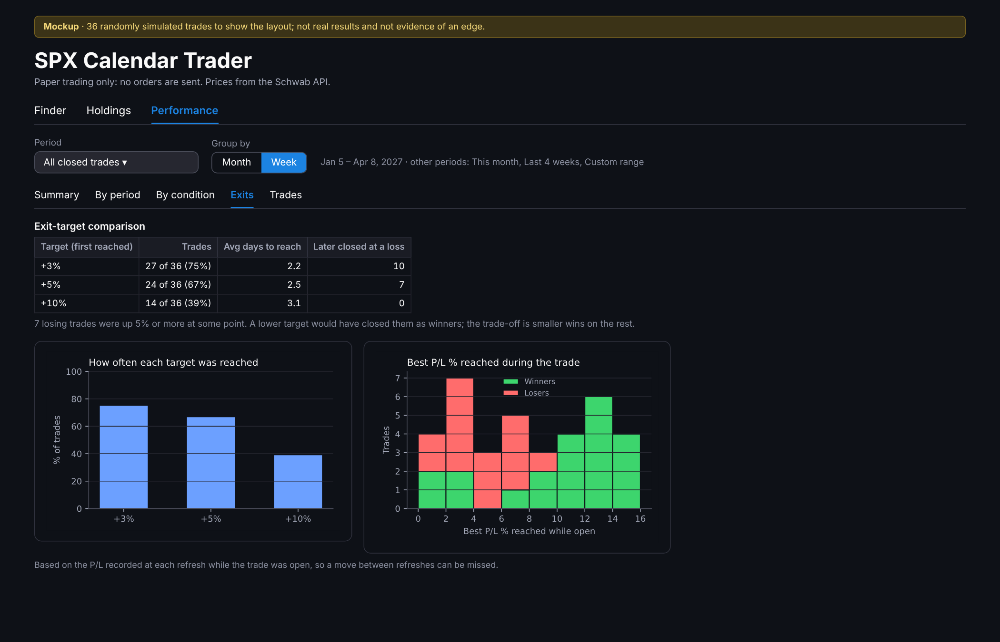
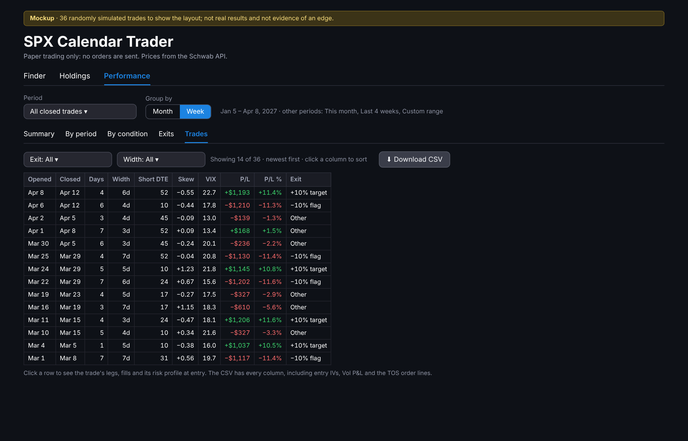

# Performance screen

The Performance screen answers one question: which entry conditions made money for you? It reads only closed trades. The full specification is in the [build plan](PLAN.md#screen-3--performance); this page walks through the screen tab by tab.

The images are mockups built from 36 randomly simulated trades to show the layout. They are not real results and not evidence of an edge. They are generated by code in [`mockups/`](mockups/README.md).

**Contents:** [Layout](#layout) · [Summary](#summary) · [By period](#by-period) · [By condition](#by-condition) · [Exits](#exits) · [Trades](#trades) · [Which release](#which-release)

## Layout

Two controls at the top apply to every tab:
- **Period:** all closed trades, this month, the last 4 weeks, or a custom date range.
- **Group by:** Month or Week, for the charts and tables that group by time.

Below them, five sub-tabs keep the screen readable on a normal-width display: Summary, By period, By condition, Exits and Trades.

## Summary

The headline numbers in two rows of four: closed trades, win rate, average win, average loss, expectancy per trade, total P/L, average days held, and how many trades hit the +10% target or the −10% flag. Below them are a wins/losses bar chart by week (or month) and the cumulative P/L.

## By period

A P/L bar chart by week or month (following the Group by switch), with the best and worst week and how many weeks made money. Below it are the monthly and weekly tables: trades, wins, losses, win rate, P/L and average days in trade. A trade counts in the period it was opened.

## By condition

Pick **one grouping at a time** with the chips: skew at entry, VIX at entry, vol at entry, entry day, short DTE at entry, days in trade, or width. Each shows a table (trades, win rate, Avg P/L, **Avg P/L %**, Avg days) and a bar chart of average P/L per bucket. Avg P/L % compares trades fairly when they were sized differently.

Set to **Width**, it compares 3-, 4-, 5-, 6- and 7-day spreads side by side:

Set to **Skew at entry**, it also shows each trade's P/L % against its entry skew:

## Exits

Would a different profit target have done better? The table shows how often each target (+3%, +5%, +10%) was first reached, the average days to reach it, and how many of those trades later closed at a loss. Two charts follow: the hit rate per target, and a histogram of the best P/L % each trade reached while open, split into winners and losers. A losing trade that was once up 5% would have been a winner with a lower target, at the cost of smaller wins on the rest.

These come from the P/L recorded at each refresh while a trade was open, so a move between refreshes can be missed.

## Trades

Every closed trade, newest first: opened, closed, days, width, short DTE, skew, VIX, P/L, P/L % and exit reason (+10% target, −10% flag, Time exit, Before an event, Delta / adjustment, or Other). Sort by any column, filter by exit reason or width, and download everything as CSV, including entry IVs, Vol P&L, the Copy to TOS order lines and the trade's notes. The exit reason is chosen from a dropdown when closing (pre-selected with the app's suggestion), and both the suggestion and the choice are saved. Clicking a row shows that trade's legs, fills and risk profile at entry.

## Which release

Release 1 (by Jan 4, 2027) builds Summary, By period's tables, By condition with the width, skew and days-in-trade groupings, the Exits table, and the Trades list with CSV export. Release 2 (by Jan 18, 2027) adds the remaining groupings, the skew scatter, the Exits charts, the By period chart, and the Trades filters and row details. See the [build plan](PLAN.md#6-week-build-plan).
