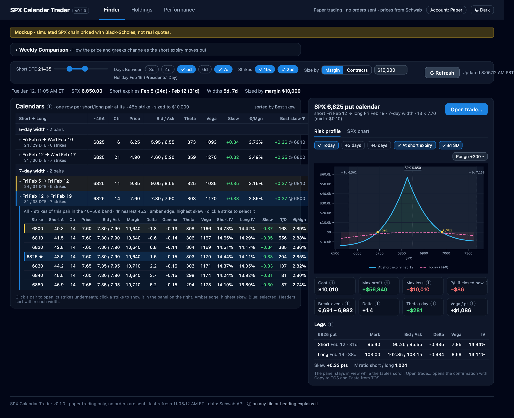
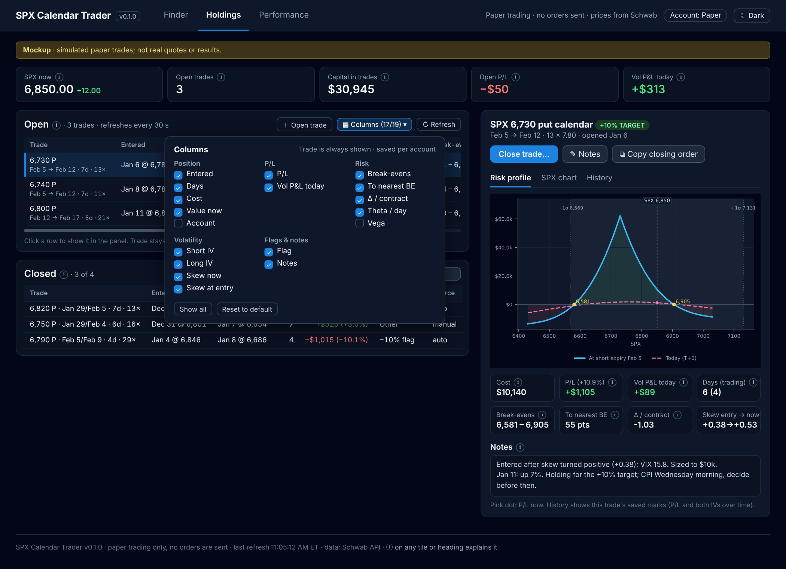
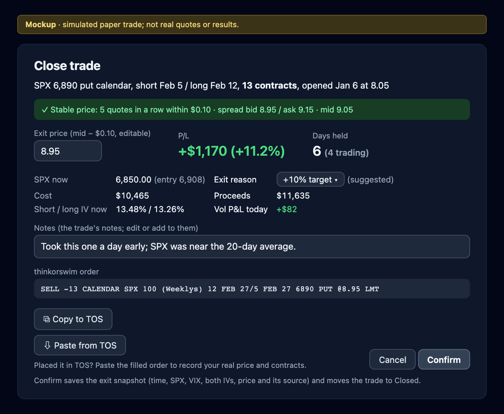
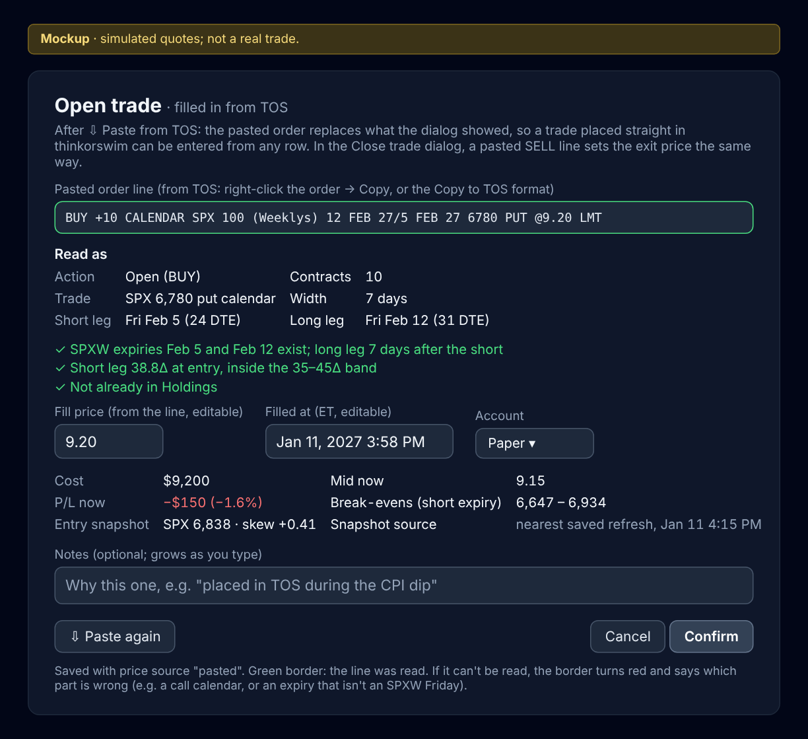

# SPX Calendar Trader — Plan

> Source of truth for scope. Exported from Lav's working doc on Nov 18, 2026; edit this file directly from here on.

## What this is

One program, three screens: the core built in 6 weeks, extras in a 2-week second release. Start it with one command (`uv run serve`), open http://localhost:8000, and it shows a calendar finder for ~45Δ SPX put calendars. You pick one, commit it as a paper trade, and then a holdings screen shows its days in trade, current profit and break-evens. Any trade down more than 10% is flagged. Every trade is logged with the market conditions at entry and exit, and a performance screen shows which conditions made money.

No real orders are sent; prices come from your Schwab API pull. Everything from earlier versions that isn't needed for this (quality lights, the eight-rule exit engine, journal statistics, notifications) has moved to Later.

## Repo setup

The repo holds only this app. It starts from three working pieces:

| File | What it gives you |
| --- | --- |
| `schwab_api.py` | Schwab login, weekly token refresh, chain pull (fixed in week 1) |
| `calendar_math.py` | The Excel sheet's columns: Price, Contracts, Margin, Greeks, Skew, T/D, Θ/Mgn, with a 16-row self-test against a reference sheet |
| `README.md` | Schwab developer-app and callback-URL setup steps |

```
SPXCalendarTrader/
  app/
    main.py             # FastAPI app: mounts /static, includes routers, Jinja2 templates
    settings.py         # pydantic-settings: Schwab keys, callback, token path, DB path, feature flags (env vars)
    pages.py            # page routes (Finder, Holdings, Performance) + the shared page_context() helper
    partials.py         # HTMX fragment routes: tables, cards, lists, dialogs
    schemas.py          # API request/response models with input validation
    api/                # JSON endpoints under /api (charts, stability check, Paste from TOS, settings)
    core/               # all trading logic, no web imports
      config.py         # margin, offsets, thresholds, widths, holidays, polling and rate limits
      models.py         # Pydantic models for service inputs and outputs
      services.py       # one function per endpoint
      schwab_api.py     # Schwab login + chain, quote and price-history pulls (moved from the repo root in week 1)
      calendar_math.py  # sizing, greeks, skew columns (moved from the repo root in week 1)
      expiries.py       # short Fridays, long dates by width, holidays
      pricing.py        # Black-Scholes (numpy/scipy), forward from put-call parity, P/L curves, break-evens
      store.py          # SQLite: trades, marks, finder_log, spx_daily, settings
    templates/          # base.html, _header.html, _footer.html, one page per screen, partials/
    static/             # js/ (one controller per page, lib/, charts/), css/style.css
  cli.py                # week 1: prints today's candidates in the terminal
  tests/                # pytest (+ TestClient); tests/js/ for node --test
  docs/                 # PLAN.md, WEEK1.md, images/, mockups/
  data/                 # paper_trades.db (not committed)
  .env.example          # Schwab keys template; copy to .env (not committed)
  pyproject.toml        # uv, Python 3.12: fastapi, uvicorn, jinja2, pydantic-settings, pandas, numpy, scipy, pydantic (+ uv.lock)
  CLAUDE.md, HANDOVER.md
```

### Architecture: FastAPI + HTMX + vanilla JavaScript

The app is a small web server. FastAPI renders each screen from Jinja templates; HTMX swaps in server-rendered pieces (tables, cards, dialogs) and refreshes them on a timer; a little vanilla JavaScript draws the charts and runs the dialogs' live checks. There is no frontend framework and no build step: Tailwind, HTMX, Chart.js and Lightweight Charts load from their CDNs. The full rules are in `CLAUDE.md`; the ones that shape this plan:

1. **All trading logic lives in `app/core/`,** with no web imports. Routes, templates and JavaScript only display what it returns.
2. **One service per endpoint.** `services.py` holds `get_finder()`, `get_holdings()`, `get_performance()`, `get_risk_profile()`, `get_spx_history()`, `quote_spread()`, `parse_tos_order()`, `open_trade()`, `close_trade()`. A JSON route under `/api` and an HTML fragment under `/partials` can wrap the same service; neither adds logic.
3. **Typed, JSON-ready inputs and outputs.** Services take and return Pydantic models (numbers, strings, ISO dates, lists), never DataFrames or NumPy types. Every `/api` endpoint declares its response model, so `/docs` documents the API.
4. **The UI only displays.** Decisions are made in services and returned as fields: `is_best_skew`, `is_near_target_delta`, `flag: "loss" | "target" | "delta" | null`, `suggested_price`, `is_stable`, `waiting_reason`, `tos_order`.
5. **Raw numbers out, formatting at the edge.** Services return 12.85, not "$12.85"; Jinja filters and `format.js` format them the same way.
6. **The database is the source of truth.** Trades, marks, the Finder log and every saved setting (per account, in the `settings` table) live in SQLite. The browser keeps only the theme (light or dark) and screen state such as the selected row.
7. **Polling is a service call.** Holdings refreshes every 30 seconds; the stability check calls `quote_spread()` every 2 seconds while a dialog is open. Polls don't write on every tick: each open trade's `marks` row is saved at most every 5 minutes, on every Refresh, and at the close snapshot after 4:15 PM ET; `finder_log` rows on a Finder Refresh and at the close snapshot.
8. **Schwab calls are gentle.** Quotes are batched (every leg plus SPX, VIX and VIX9D in one call), chain and quote pulls are cached for 15–30 seconds across tabs, at most 4 run at once under a 100-per-minute limit, with backoff if Schwab says to slow down. At the planned rates the app uses about 35 requests a minute at its busiest (a dialog's stability check plus Holdings polling).
9. **Settings in one file.** Default margin ($10,000) and size modes, fill offset ($0.10), stability range and window, flag levels, delta band, short-DTE limits and default, widths, strike sets, holidays, the close-snapshot time, polling intervals and rate limits live in `app/core/config.py`. Keys and paths come from environment variables (`app/settings.py`).
10. **Tests target services and API routes, not screens.**
11. **Pieces named like components:** `FinderFilters`, `StatusStrip`, `CalendarsTable` (with its `StrikeRows`), `CalendarPanel`, `SpxChart`, `RiskProfileChart`, `LegsTable`, `OpenTradeDialog`, `HoldingsTable`, `TradePanel`, `CloseTradeDialog`, `PerformancePanel`.

Every screen shares a header (app name and version, the Finder / Holdings / Performance tabs, the account, a light/dark theme toggle; dark by default) and a footer (version, "paper trading only", last refresh). Every tile, heading and control has a small ⓘ that explains it.

Schwab setup is in `README.md`. The token lives in `~/.schwab/`, outside the repo, and needs one re-login each week.

## The trade

| Leg | Expiry | Strike |
| --- | --- | --- |
| Short | A Friday whose DTE is inside the **short-leg DTE filter** (7–56 days, i.e. 1–8 weeks out; default 25–35, the Friday nearest 30 DTE). **If that Friday is a market holiday, the Thursday before** (Good Friday, Christmas or New Year's Day on a Friday) | Put, ~45Δ (40–50Δ band), on the strikes switched on: **10s** (multiples of 10) and/or **25s** (multiples of 25); both by default, which gives the 10s plus the 25s and 75s |
| Long | **3, 4, 5, 6 or 7 days after the short's Friday** (SPXW expires every weekday: Mon, Tue, Wed, Thu, next Fri), for each width switched on (default 7). Widths are counted from the nominal Friday, not from the adjusted Thursday. **If the long's day is a market holiday, it moves to the day before too** (a 7-day long on a Friday holiday becomes that Thursday); if that lands on or before the short, the width isn't offered that week. Both legs follow the same rule, so a holiday Friday never leaves a leg with no expiry | Same strike as the short |

The default trade is unchanged: short the Friday nearest 30 DTE, long 7 days later, ~45Δ. The filters widen what the Finder shows. Each saved trade records its short DTE and width, so Performance can compare them.

**Sizing.** By default each trade is sized to **$10,000 of margin**: contracts = margin ÷ (debit × 100), rounded up, the same way `calendar_math.py` sizes the Excel sheet's rows. A calendar's margin is its debit. A **Size by** control lets you change this: **Margin** with any amount you type (default $10,000), or **Contracts** with a fixed number (margin then = debit × 100 × contracts). It applies to the Finder's Contracts and Margin columns and can be overridden per trade in the open dialog. Trades store the sizing mode and value used.

## Screen 1 — Calendar finder

It looks like the Excel sheet, fed by Schwab instead of the live Excel price feed.

**Colors.** Buttons are grey on every screen, with Confirm and Refresh a lighter grey; the one main action in a panel (**Open trade…**, **Close trade…**) is solid blue. **Blue marks what is selected:** chips and toggles that are on, the active tab, the slider, checked boxes and the selected table row. Set it once as Tailwind's `primary` color (`#1C83E1`) in `base.html`, which colors all of these. **Red is only for warnings and losses** (the LOSS flag, negative P/L), with green for gains and the TARGET flag, so red always means something needs attention.

**Layout.** The Finder is built for one decision at a time: pick a pair, look at its strikes, check the risk, open the trade, without scrolling between them.
- **Filter bar** across the top, all on one line: Short DTE (range slider), Width chips, Strike chips, Size by (Margin or Contracts, with the amount), and **↻ Refresh** with the time of the last pull on the right. The settings are saved, so the Finder opens the way you left it.
- **Status strip** under it: time (ET), SPX, the short expiries in the DTE range with their DTEs, the widths on and the sizing.
- **Two columns** below: the **Calendars** table on the left, and on the right a **panel for the selected calendar** that stays in view while the tables scroll. The three screens are tabs in the header.

The filters:
- **Short-leg DTE:** a range slider from 7 to 56 days (1–8 weeks out); every Friday expiry inside the range is used. Default 25–35.
- **Days between short and long:** on/off chips for 3, 4, 5, 6 and 7 days; any combination. Default 7 only. A chip is crossed out when no expiry exists for it that week.
- **Strikes:** on/off chips for **10s** (multiples of 10) and **25s** (multiples of 25); check one or both. Default both.
- **Size by:** Margin (amount, default $10,000) or Contracts (a fixed number).

**Calendars table (left).** Press Refresh and it pulls the chain and fills it:
- **One row per short/long pair**, at that pair's ~45Δ strike. The first cell shows both expiries ("Fri Feb 12 → Fri Feb 19") with the DTEs and the number of strikes under them; then the ~45Δ strike, Contracts, Price, Theta, Vega, Skew, Θ/Mgn and **Best skew** (the highest skew among the pair's strikes, and at which strike). Margin is in the strike rows and the panel (it is about the same for every row when sizing by margin).
- **Split into one segment per width** (a header row such as "7-day width · 2 pairs"), narrowest first. Click a column header to sort within each segment, for example by Best skew.
- **Click a pair and its strikes open underneath it** (▸ / ▾), indented with a blue edge: every strike from 35Δ to 45Δ with the sheet's columns (Strike, Short Δ, Contracts, Price, Margin, Delta, Gamma, Theta, Vega, Skew, T/D, Θ/Mgn). The strike nearest 40Δ is starred. T/D shows "—" when position delta is near zero, where it means nothing. One pair is open at a time.
- **Markers instead of filled rows:** an amber left edge on the highest-skew pair and on the highest-skew strike in the open pair; a blue tint and blue left edge on the selected pair and strike. Rows have thin separators and no vertical gridlines; numbers are right-aligned with tabular digits; the header row stays in place while the table scrolls.
- **Click a strike** to show it in the panel on the right.

**Selected calendar panel (right).** Title (strike, expiries, width, contracts × price at mid + $0.10) and an **Open trade…** button that opens the confirmation (see Trade panel below). Two tabs:
- **Risk profile** (default): the chart described below, with its line chips, ±1 SD toggle and a Range selector (±150 / ±300 / ±500), then eight tiles: Cost, Max profit, Max loss, P/L if closed now, Break-evens, Delta, Theta / day, Vega / pt.
- **SPX chart:** the daily chart described below, with its range and overlay chips and four tiles: distance from the 3-month high, 5-day change, 20-day realized vol and the short leg's IV.
- **Legs** under both tabs: the short and long puts with expiry and DTE, mark, bid / ask, delta, vega and IV, then **Skew** (short IV − long IV, in vol points) and the **IV ratio** (short IV ÷ long IV), the two numbers that say whether the term structure favours the calendar.

When the Finder first loads, the pair holding the default trade (Friday nearest 30 DTE, 7 days wide) is open, with its ~45Δ strike selected. Which pair and strike are selected is screen state only (held in the page's JavaScript), never stored. The table is an HTML fragment rendered on the server (`partials/_calendars_table.html`, with the strike rows from `partials/_strike_rows.html`); clicking a header re-sorts within the segments, clicking a pair loads its strike rows with HTMX, and clicking a strike loads the panel (`partials/_calendar_panel.html`) and the chart data.

**SPX chart.** Daily candles for SPX, **3 months by default**, with range chips 1M, 3M, 6M, 1Y and 2Y to zoom out.
- **Overlays** (on/off chips): the 20- and 50-day averages; the selected calendar's strike (red dashed) with its break-evens at the short expiry as a shaded band; and the short and long expiries as dashed lines to the right of today, so the tent is drawn against recent price swings.
- **Stats above the chart:** high and low over the range, distance from the high, 5-day change, distance from the 20-day average, and 20-day realized vol next to the short leg's IV (a calendar does best when SPX moves less than the short leg's IV implies).
- **Data:** Schwab's price history endpoint (`GET /marketdata/v1/pricehistory`, symbol `$SPX`, daily bars) through a new `schwab_api.get_daily_bars(symbol, years=2)`. Bars are stored in a `spx_daily` table and only the missing days are pulled, so it costs one small request a day. Today's bar uses the live SPX mark.
- **Service:** `get_spx_history(range)` returns the bars, the averages and the stats; the overlays come from the selected strike, so the chart updates when another strike is selected. Drawn with TradingView Lightweight Charts in `static/js/charts/spxchart.js` from `GET /api/spx-history` (hover shows open, high, low and close; the strike, break-evens band and expiries are price lines and markers).




**Risk profile.** A P/L chart for the selected calendar, like thinkorswim Analyze, shown in the Finder's panel for the selected strike (sized as it would open) and in the Holdings panel for the selected trade (at its fill price, with a dot for P/L now).
- **Lines** (on/off chips): Today, +3 days, +5 days, and At short expiry (default: Today and At short expiry). Each line is P/L at that date across SPX, with both legs repriced by Black-Scholes at their current IVs, held constant; at the short expiry the short leg is worth its intrinsic value.
- **Marks:** break-evens at the short expiry, a line and label at SPX now, the P/L-now point in Holdings, green shading where the At-short-expiry line is above $0 and red where it is below, and a grey **±1 SD band** (on by default): SPX now ± SPX × short-leg IV × √(days to the short expiry ÷ 365), labelled with its two levels, so you can see how much of the expected move the tent covers.
- **SPX range:** ±150, ±300 (default) or ±500 points around the strike.
- **Tiles under the chart:** cost, max profit at the short expiry, max loss (the debit), P/L if closed now, break-evens, delta, theta per day, vega per vol point (Holdings shows the trade's own tiles; see Screen 2).
- The service `get_risk_profile()` returns the SPX grid, one P/L series per line, the break-evens, the ±1 SD levels and the stats; the UI only draws them.

**How the risk profile is computed.** Not from the greeks: they only describe small moves, and a calendar's shape changes a lot across a ±300-point range (the tent at the short expiry is the clearest case). Instead both legs are repriced on a grid, the way thinkorswim Analyze does it. All of this lives in `pricing.py`, in plain numpy and `scipy.stats.norm`, with no pricing library:
1. **Grid:** SPX from strike − range to strike + range, every 2 points (301 points at ±300).
2. **Dates:** for each line, the days left on each leg: today, today + 3, today + 5 (trading days, holidays skipped) and the short expiry. Time is in years: calendar days / 365, plus the fraction of today left until 4:00 PM ET.
3. **Price each put with Black-Scholes:** SPX options are European and cash-settled, so Black-Scholes is the right model. Use the forward form, `put = e^(−rT)·[K·N(−d2) − F·N(−d1)]`, with each leg's own forward F. Each leg keeps the IV it has now (sticky IV, the thinkorswim default). At the short expiry the short put is worth its intrinsic value, `max(K − S, 0)`.
4. **P/L:** `(long value − short value − debit) × 100 × contracts`, where the debit is the mid (Finder) or the fill price (Holdings).
5. **Break-evens:** where the At-short-expiry line crosses $0, found with `scipy.optimize.brentq` on each side of the strike (the same function the Holdings break-evens use).
6. **Stats:** max profit = the highest point of the At-short-expiry line; max loss = the debit; P/L now = today's line at SPX now; delta, theta and vega are the sum of the two legs' greeks from the chain × 100 × contracts.

**Rates and dividends.** Rather than hard-code them, each expiry's forward comes from the chain by put-call parity at the strike nearest the money: `F = K + e^(rT)·(call − put)`, with r from settings (default 4.0%; it matters little for a 5-week option). This absorbs the dividend yield, so there is no separate dividend input. For dates in the grid, the forward is moved with SPX: `F = S·(F_now / S_now)`.

**Checks (tests/test_pricing.py):**
- The put price matches a known reference value to the cent (e.g. from py_vollib or a textbook example).
- Today's line at SPX now equals the spread's current mid, so P/L now ≈ $0 at entry, and equals the Holdings P/L for an open trade.
- Break-evens are within about 5% of thinkorswim Analyze for the same calendar (the week-1 target).
- Put-call parity on the pulled chain gives a forward within a few points of SPX for near expiries.

**Drawing it: canvas.** `static/js/charts/riskgraph.js` paints the service output on an HTML5 `<canvas>`: one line per curve (solid sky blue At short expiry, dashed pink Today, dash-dot violet and teal for +3 and +5 days; red is kept for losses), green and red shading above and below $0, the ±1 SD band, a $0 line, a dotted vertical line and label at SPX now, yellow markers with labels at the break-evens, the legend under the chart, and the P/L-now dot in Holdings. Hovering shows a crosshair with SPX and the P/L of every line at that point; the mouse wheel zooms and dragging pans. The line chips set which lines are drawn. It is read-only in Release 1; the Analyzer in Application Phase 2 grows out of the same file (dragging strikes, adding legs, Time and IV sliders computed in the browser), so `get_risk_profile()` doesn't change.

**Later:** reprice with each strike's IV from the chain's skew as SPX moves (sticky strike) instead of holding IVs fixed; and add a vol shift (e.g. ±2 points on both legs) to see Vol P&L on the chart.

The Finder and Holdings mockups both show it.

**Trade panel.** The Finder's panel already shows the selected strike, expiries, contracts, price, cost and break-evens. Press **Open trade…** to see the confirmation, which waits for a stable mid (see Fill rules); nothing is saved until you press Confirm.

**Open confirmation** shows the details with the fill price in an editable box and the **Size by** control (Margin amount or Contracts) pre-filled from the Finder, so one trade can be sized differently; for example: "Open trade: SPX 6,750 put calendar, short Dec 18 / long Dec 24, 8 contracts at $12.85 = $10,280. SPX 6,812.40, skew +1.1. Target +10% at $14.14, flag −10% at $11.57." **Confirm** saves the trade and its entry snapshot; **Cancel** saves nothing. A short "Trade opened" message follows. The dialog also has a **Copy to TOS order** button (see below).


**Fill rules:**

- **Price.** Opening fills at the spread's mid + $0.10; closing fills at mid − $0.10. The mid is (bid + ask) ÷ 2 of the calendar, built from both legs' quotes.
- **Stable mid first.** When the confirmation opens, the app re-quotes the two legs every 2 seconds. It fills only after 5 quotes in a row (about 10 seconds) stay within a $0.10 high-to-low range and the spread's bid-ask is no wider than 10% of the mid.
- **While it waits**, the confirmation says why, for example "Waiting for a stable price: mid moved $0.25 in the last 10 seconds." After 60 seconds without a stable mid, it asks whether to keep waiting or cancel.
- **What gets saved:** the market quote and your fill in separate columns, so editing the price never overwrites the quote. Market columns: bid, ask, mid at the moment you confirm, and the high-to-low range seen during the check. Price columns: the suggested price (mid ± $0.10), the fill price you confirmed, and the price source (auto or manual). The same set is saved for the open and for the close.
- Re-quoting uses Schwab's quotes call for just the two legs, about 30 requests a minute, well inside Schwab's per-minute limit.
- **Edit the price.** The confirmation shows the fill price in an editable box, pre-filled with mid ± $0.10 once the mid is stable. You can type your own price at any time, including while it is still waiting; P/L, contracts, target and flag prices update as you type. A typed price outside the calendar's bid–ask gets a warning ("$13.60 is above the ask of $13.40; a real order wouldn't fill there") but can still be confirmed. The trade is saved with a "manual price" tag, so the Performance screen can show manual and automatic fills separately.

## Screen 2 — Holdings

One row per open paper trade, re-priced from Schwab on each Refresh.

**Layout.** Five summary cards across the top: **SPX now** (with today's change), open trades, capital in trades, open P/L and Vol P&L today. Below them, two columns like the Finder: the **Open** table and the **Closed** list on the left, and a **panel for the selected trade** on the right that stays in view.

The Open table's toolbar sits on the heading line ("Open · 3 trades · refreshes every 30 s"):
- **＋ Open trade:** opens an empty Open trade dialog, filled in with **⇩ Paste from TOS**, for a trade placed straight in thinkorswim. (Trades found in the Finder still open from the Finder's panel.)
- **▦ Columns:** a popover with a checkbox per column, grouped (Position, P/L, Risk, Volatility, Flags & notes), with Show all and Reset to default. **Trade** is always shown. The choice is saved (in the `settings` table, per account) and comes back next time.
- **↻ Refresh.**

Click a row to select it (blue tint and left edge). There are no per-row buttons; the actions are in the panel:
- **Title:** strike, expiries, contracts × fill price, the date opened, and the trade's flag badges.
- **Buttons:** **Close trade…** (opens the Close trade dialog), **✎ Notes**, and **⧉ Copy closing order** (the TOS line for closing at mid − $0.10).
- **Tabs:** **Risk profile** (at the fill price, with the pink P/L-now dot), **SPX chart** (the Finder's daily chart, with this trade's strike, break-evens band and expiries drawn on) and **History** (Release 2: this trade's saved marks, P/L % and both IVs over time).
- **Tiles:** Cost, P/L ($ with % in the label), Vol P&L today, Days (trading days), Break-evens, To nearest BE, Δ / contract, Skew at entry → now.
- **Notes:** the trade's notes, shown in full.

**Scrolling.** The table never squeezes columns: when the chosen columns are wider than the screen, it scrolls sideways, with **Trade pinned on the left** so you always know which row you are reading. The table is an HTML fragment (`partials/_holdings_table.html`) inside a horizontally scrolling box, with the Trade column `position: sticky` on the left; it shows the columns from the saved Columns choice. Clicking a row selects it, as on the Finder.




| Column | What it shows | Shown by default |
| --- | --- | --- |
| Trade | Strike, short/long expiry, width (days), contracts | always |
| Entered | Date and SPX at commit | |
| Days | Calendar days since commit (trading days in brackets) | ✓ |
| Cost | Fill price × 100 × contracts | |
| Value now | (Current mid − $0.10) × 100 × contracts, what closing now would get | |
| Account | Which account the trade is in (Paper for now) | |
| P/L | Value now − cost, in $ and as % of cost | ✓ |
| Vol P&L today | The dollar effect of today's IV changes on the two legs since the previous close (see Vol P&L below); shows whether a day's P/L came from volatility or from SPX moving | ✓ |
| Break-evens | Lower and upper SPX levels where the trade is at $0 P/L on the short expiry, the way thinkorswim shows them | ✓ |
| To nearest BE | Distance from SPX now to the nearer break-even, in points (SPX itself is in the summary cards) | ✓ |
| Δ / contract | Position delta ÷ contracts | ✓ |
| Theta / day | Position theta in $ per day | |
| Vega | Position vega in $ per vol point | |
| Short IV, Long IV | Each leg's IV now | |
| Skew now | Short IV − long IV now, in vol points | |
| Skew at entry | The same at entry, from the entry snapshot | ✓ |
| Flag | See below | ✓ |
| Notes | A **✎ View** button that opens the trade's notes (**✎ Add** when there are none); the text itself isn't shown in the row | ✓ |

**Notes.** Each trade has **one Notes box**, free text that grows with its length (one line when empty, as many as it needs). Use it for why you entered, what you're watching and why you closed. The Notes column has only a button: **✎ View** opens the trade's notes, **✎ Add** when there are none; the text isn't shown in the row. The same notes show, and can be edited, in the Open trade dialog (empty, optional), the Close trade dialog (pre-filled) and the Notes dialog. They stay with the trade after it closes and appear in Performance → Trades and in the CSV export. Stored as `notes` and `notes_updated_at` on the `trades` row.


**Flags:**

- Red **LOSS > 10%** when P/L is −10% of cost or worse
- Green **+10% TARGET** when P/L is +10% or better
- Amber **DELTA > 2** when position delta is more than 2 per contract either way (Tom Conley's comfort limit)

**Close trade…** (in the panel) closes the selected paper trade at mid − $0.10 (after the same stability check as opening) and moves it to the **Closed** list below the Open table (trade, entered, exited, days held, P/L, exit reason, price source). The Closed list shows **the last 7 days by default**, with a dropdown for 14, 30 or 90 days, or All; the choice is saved with the other Holdings settings. The heading shows how many are listed out of the total (e.g. "3 of 4 closed trades"). The full history, with filters and CSV, is in Performance → Trades.

**Close confirmation** shows the exit price in an editable box (mid − $0.10 after the same stability check, or your own price), P/L in $ and %, days held and SPX now, for example: "Close trade: SPX 6,750 put calendar, 8 contracts at $14.20. P/L +$1,080 (+10.5%), 4 days." The **exit reason** is a dropdown, pre-selected with the app's suggestion: **+10% target** or **−10% flag** if the trade was flagged when closed, otherwise **Other**. The choices are +10% target, −10% flag, Time exit, Before an event, Delta / adjustment, and Other. Both the suggestion and your choice are saved (`exit_reason_suggested`, `exit_reason`); Performance groups and filters by your choice. The **Notes** box shows the trade's notes, pre-filled, to add the why. **Confirm** saves the exit snapshot and moves it to Closed; **Cancel** leaves it open.



**Copy to TOS.** The Open trade and Close trade dialogs have a **Copy to TOS** button that copies the trade as a thinkorswim order line, ready to paste into TOS order entry: the open dialog copies the opening order, and the close dialog copies the closing order (Holdings rows have no button of their own). It uses the price in the box at that moment (mid ± $0.10 or your own). For example:

```
BUY +13 CALENDAR SPX 100 (Weeklys) 19 FEB 27/12 FEB 27 6800 PUT @7.70 LMT
SELL -13 CALENDAR SPX 100 (Weeklys) 12 FEB 27/5 FEB 27 6735 PUT @8.70 LMT
```

**Paste from TOS.** The Open trade and Close trade dialogs have a **⇩ Paste from TOS** button directly below Copy to TOS. Paste an order line copied from thinkorswim, in the same format Copy to TOS writes (for example `BUY +10 CALENDAR SPX 100 (Weeklys) 12 FEB 27/5 FEB 27 6780 PUT @9.20 LMT`), and the dialog takes its trade, price and contracts from it. Two uses: recording the price you actually got in TOS, and entering a trade placed straight in thinkorswim from any row, without building it in the Finder.
- **What it reads:** BUY or SELL, contracts, the two expiries (in either order; the earlier one is the short), strike, PUT, and the limit price. The service `parse_tos_order(text)` returns these fields or says which part it couldn't read; the parsing has its own tests.
- **Open trade dialog (BUY line):** the pasted order replaces what the dialog showed. Checks: both expiries are SPXW dates, the width is 3–7 days, it is a put calendar (calls are refused for now), and the trade isn't already in Holdings; the short leg's delta is shown, with a warning (not a block) outside 40–50Δ. The fill price comes from the line and the fill time defaults to now; both are editable, for a trade filled earlier. Contracts come from the line, not from Size by. The entry snapshot (SPX, VIX, IVs, skew, break-evens) is taken from the nearest saved Finder refresh to the fill time, or from a fresh quote if there is none, and the dialog says which. Saved with `price_source = "pasted"`.
- **Close trade dialog (SELL line):** the line must match the trade being closed (strike, expiries, contracts); it sets the exit price and, if edited, the exit time. A partial close (fewer contracts) is refused for now.
- A SELL line in the open dialog, or a BUY line in the close dialog, is refused with a message saying which dialog it belongs in.



The service builds the line and returns it as a `tos_order` field; the UI only copies it. The app still sends no orders. Before building, copy a real calendar order from TOS and match its exact format (leg order, the `(Weeklys)` tag for SPXW, date style).

**Two things to know about the numbers.** P/L includes the $0.10 cost on both the way in and the way out, so a +10% flag is +10% after fills, not before. And if you use the −10% flag as your exit, a +10% / −10% pair needs you to win just over half your trades before costs, a much lower bar than the +10% / −20% pair in earlier versions.

### Vol P&L (from Tom Conley)

Volatility, not SPX price, drives most of a calendar's day-to-day P/L. Vol P&L isolates that part:

Vol P&L = [(short IV now − short IV at previous close) × short-leg vega × (−1) + (long IV now − long IV at previous close) × long-leg vega] × 100 × contracts

IVs are in vol points and vegas per share, so a short-leg IV drop helps the trade and a long-leg IV drop hurts it. It ignores delta and theta on purpose. The **previous close** is the last refresh after 4:15 PM ET (when SPX options stop trading) on the previous trading day. If there was none, the last refresh of that day stands in, and the screen says so. Holdings takes it from each trade's own `marks` rows; the Finder (entry snapshot, and later the Finder columns) takes it from `finder_log`.

## Where trades are stored

All trades live in one SQLite file, `data/paper_trades.db`. It is kept out of git (`*.db` in `.gitignore`), it is a single file you can copy to back up, and the Performance screen exports it to CSV for Excel.

Five tables:

| Table | One row per | What it holds |
| --- | --- | --- |
| `trades` | Paper trade | The account it belongs to, the trade (strike, expiries, width, short DTE at entry, sizing mode and value, contracts, fill, cost) plus a market snapshot at entry and at exit (below), exit reason, P/L, days held |
| `marks` | Trade per saved refresh (every Refresh, at most every 5 minutes while Holdings polls, and the 4:15 PM close) | Time, SPX, spread mid, short and long IV, short and long vega, P/L %, Vol P&L; gives you each trade's path, its worst point and its best point |
| `finder_log` | Strike × expiry pair per finder refresh | Time, SPX, VIX, short and long expiries, width, strike, calendar mark, delta, short and long IV, short and long vega, skew, whether it was the best-skew row, and whether you traded; the whole ladder, so you can see what the market offered on days you passed and compute Vol P&L against the previous close |
| `spx_daily` | One row per trading day | Date, SPX open, high, low, close; topped up from Schwab price history (only missing days are pulled) |
| `settings` | One row per account and setting | Screen settings that should survive a restart: the Finder settings, which Holdings columns are shown, the Closed-list window, chart range and overlay chips (the light/dark theme is the one preference kept in the browser) |

**Snapshot saved at entry, and again at exit:**

| Field | Source |
| --- | --- |
| Date and time | Clock at commit |
| SPX | Schwab quote |
| VIX and VIX9D | Schwab quotes (`$VIX`, `$VIX9D`) |
| Short-leg IV, long-leg IV | The two legs' IVs from the chain |
| Skew | Short IV − long IV, in vol points |
| Break-evens | Lower and upper SPX at $0 P/L on the short expiry |
| Vol P&L at entry | The chosen strike's Vol P&L that day, from `finder_log` (entry only) |
| Time of day | Clock at commit (entry only), for the time-of-day grouping |

## Screen 3 — Performance

It answers one question: which entry conditions made money for you? It reads only closed trades.

A tab-by-tab walkthrough with screenshots is in [PERFORMANCE.md](PERFORMANCE.md).

**Layout.** So it stays readable on a normal screen, the Period filter and Month/Week switch sit at the top, and the rest is split into **five sub-tabs**:
- **Summary:** the summary row (two rows of four), the wins/losses chart and the cumulative P/L chart.
- **By period:** a P/L bar chart per week or month (follows the Month/Week switch), best and worst week, then the monthly and weekly tables, stacked.
- **By condition:** chips to pick **one** grouping at a time (skew, VIX, short IV vs VIX, vol at entry, entry day, short DTE, days in trade, width), shown as a table with trades, win rate, Avg P/L, **Avg P/L %** and Avg days, plus a bar chart of average P/L per bucket. For example, Width compares 3-, 4-, 5-, 6- and 7-day spreads side by side. The P/L-vs-skew scatter appears with the skew grouping.
- **Exits:** the exit-target comparison (how often +3%, +5% and +10% were first reached, average days to reach, and how many of those later closed at a loss), a bar chart of hit rates, and a histogram of the best P/L % each trade reached while open, split into winners and losers.
- **Trades:** the closed-trade list (opened, closed, days, width, short DTE, skew, VIX, P/L, P/L %, exit reason), newest first, sortable, with Exit and Width filters and CSV export (notes included). Clicking a row shows its legs, fills and risk profile at entry.


**Filters (top of the screen):** a **Period** picker (all closed trades, this month, last 4 weeks, or a custom date range) and a **Group by** switch (Month or Week). Everything on the screen (summary row, tables, charts) uses only trades in the chosen period, grouped by entry date.

**Wins and losses chart:** a bar chart with a green bar for wins and a red bar for losses in each month or week, following the Group by switch.

**By period:** two tables, monthly performance and weekly performance, each with trades, wins, losses, win rate, P/L and average days in trade for that month or week.


**Summary row:** number of trades, win rate, average win, average loss, expectancy per trade, total P/L, average days held, and how many hit +10% versus the −10% flag.

**By entry condition** (the By condition tab): trades, win rate, average P/L, average P/L % and average days in trade, grouped by each of these, so you can see which conditions helped:

| Group by | Buckets (defaults) |
| --- | --- |
| Skew at entry | Below 0, 0 to +1, above +1 vol point |
| VIX at entry | Under 15, 15–20, over 20 |
| Short-leg IV vs VIX | Short IV above VIX, or below |
| Entry day | Mon to Fri |
| Short DTE at entry | 7–14, 15–28, 29–42, 43–56 days |
| Width | 3, 4, 5, 6, 7 days (compares average profit of 3-, 5- and 7-day spreads) |
| Days in trade | 1 to 7 days held (compares average profit of trades held 3, 5 or 7 days) |
| Vol at entry (Tom Conley's entry rule) | Volatility had moved against the spread that day (Vol P&L < 0), or not |

**Exit-target comparison:** from each trade's `marks` path, how often trades first reached +3%, +5% and +10%, how many days each took, and the average final P/L. This compares quick exits like Tom's (often 1–5% in about 2 days) with the +10% target on the same trades, without changing the rules you trade by.

**Two charts:** cumulative P/L over time, and P/L % against entry skew (one dot per trade).

**Trade list:** every closed trade with its entry and exit snapshot side by side, sortable, with a CSV export button.

Groups need about 10 trades each before they mean much, so expect 30–40 closed paper trades before drawing conclusions. At 2–3 trades a week, that is roughly 3–4 months.

## 6-week build plan

Six weeks at about 6–8 hours a week, Nov 24, 2026 to Jan 4, 2027, with Claude Code writing most of the code. The app is FastAPI with Jinja templates, HTMX and a little vanilla JavaScript: no frontend framework, no build step, and it starts with one command. Weeks 1, 5 and 6 contain holidays (Thanksgiving, Christmas, New Year), so they carry less work.

**Two releases.** Release 1 (weeks 1–6) is the core loop: find a calendar, open a paper trade, track it in Holdings, close it, and see results. **The 6 weeks are fixed:** if a week runs over, its unfinished items move to [Release 2](#release-2-jan-518-2027) rather than pushing the date. Release 2 (two weeks, Jan 5–18, 2027) adds the extras listed there; the screen descriptions above cover both releases. The second half of week 6 is kept as buffer.

### Week 1 — Schwab data and calendar pricing (Nov 24–30, Thanksgiving week)

Step-by-step version: [WEEK1.md](WEEK1.md).

- [x] Starting files in place; `calendar_math.py` self-test passes 16/16
- [x] Fix the pull: use one strike for both legs, return the 40–50Δ puts for the chosen expiries on the strikes switched on (10s and/or 25s), keep SPXW contracts on the third-Friday expiry, and limit the pull to 63 DTE
- [x] Expiry picker: every Friday in the short-leg DTE range (default 25–35), each paired with longs 3–7 days later for the widths switched on (default 7); holidays handled
- [x] Calendar pricer in `pricing.py`: Black-Scholes put (forward form), forward per expiry from put-call parity (the chain pull adds the calls nearest the money, which parity needs), value at mid now, P/L across SPX levels on the short expiry and on any date before it, break-evens with `brentq`; `tests/test_pricing.py` (see How the risk profile is computed)
- [x] Move `schwab_api.py` and `calendar_math.py` into `app/core/` and make the Schwab code safe to call from a web server: exceptions instead of `sys.exit`, the 7-day login age kept separately from the 30-minute access-token refresh, market dates in New York time, a lock around token refresh, a short cache and a rate limiter (see WEEK1.md, step 4)
- [x] Services skeleton; `get_finder()` with filters and Size by (margin or contracts); `cli.py candidates`

Done when one command prints today's candidates and a calendar's break-evens are within about 5% of thinkorswim Analyze.

### Week 2 — App skeleton and Finder screen (Dec 1–7)

Step-by-step version: [WEEK2.md](WEEK2.md).

- [x] `uv add fastapi "uvicorn[standard]" jinja2 pydantic-settings` and `uv remove streamlit`; `[project.scripts] serve = "app.main:serve"` in `pyproject.toml` (with `[tool.uv] package = true` so uv installs the script); FastAPI app (`app/main.py`, with a `serve()` function behind the `uv run serve` script) with `base.html`, the header (tabs, account, theme toggle) and footer partials, `page_context()`, `/static`, `GET /api/health`, and `GET /api/spot` + `GET /api/expirations`; `/docs` lists them; `.vscode/launch.json` gets an **App** configuration (uvicorn with reload) in place of the old Streamlit one
- [x] Finder filter bar: short-leg DTE range (7–56, default 25–35), width chips (3–7 days, default 7), Size by (Margin, default $10,000, or Contracts), strike chips (10s and/or 25s, default both); saved in the `settings` table
- [x] Finder page: Calendars table (one row per short/long pair at ~45Δ, one segment per width, sortable within segments; click a pair to open its strike rows underneath, click a strike to select it) and the selected calendar panel, as HTMX partials over `get_finder()`
- [x] Save every Finder row (the whole strike ladder) to `finder_log` on each refresh, so daily closes start collecting for Vol P&L
- [x] Selected calendar panel: Open trade… button, tiles (cost, break-evens, delta, theta, vega from `get_finder()`), and Legs with skew and IV ratio; its Risk profile tab is added in week 3
- [x] Status strip (time, SPX, short expiries, sizing) under the filter bar
- [ ] Copy a real calendar order from TOS to confirm the Copy to TOS line format (needed in week 3)

Done when `uv run serve` serves the Finder, a refresh fills the Calendars table and the panel for the chosen filters, and the default pair's numbers match the CLI.

Status (Nov 23): everything above is built and committed except the last box (a real TOS order, yours) and the first run of the web layer on your Mac; see the status block at the top of [WEEK2.md](WEEK2.md).

### Week 3 — Opening paper trades (Dec 8–14)

Step-by-step version: [WEEK3.md](WEEK3.md).

- [ ] `trades` rows carry an `account` column (default "Paper"), ready for multiple accounts later
- [ ] Open trade… in the Finder's panel opens a confirmation ("Open trade"), and Confirm saves the trade and its entry snapshot (time, SPX, VIX, VIX9D, short and long IV, skew, break-evens, Vol P&L at entry, width, short DTE, sizing) to the `trades` table
- [ ] Stability check (5 quotes in 10 seconds within $0.10, spread ≤ 10% of mid) with a waiting reason and a 60-second keep-waiting prompt; fill at mid + $0.10 in an editable box, with a bid–ask warning and the manual-price tag
- [ ] Size by override in the open dialog
- [ ] Copy to TOS button in the open dialog (`tos_order` from the service)
- [ ] Paste from TOS in the open dialog, below Copy to TOS: `parse_tos_order()` with tests (good lines and each kind of bad one), the checks, editable fill price and time, entry snapshot from the nearest saved refresh, `price_source = "pasted"`
- [ ] Risk profile tab in the Finder panel (moved from week 2, which was the fullest week):  `get_risk_profile()` (Today and At-short-expiry lines, profit/loss shading, ±1 SD band, break-evens, tiles) at `GET /api/risk-profile`, painted on canvas by `charts/riskgraph.js` (read-only: hover crosshair, zoom, pan)
- [ ] ⓘ popovers on the Finder's tiles and controls (moved from week 2)

Done when you can refresh, pick a 45Δ calendar and commit it in under a minute.

### Week 4 — Holdings screen (Dec 15–21)

- [ ] Holdings table: days in trade, cost, value now, P/L $ and %, break-evens, SPX distance
- [ ] LOSS > 10%, +10% TARGET and DELTA > 2 flags; Delta / contract column
- [ ] Vol P&L today column, using the previous close from the trade's `marks` rows; marks rows store both vegas and Vol P&L
- [ ] Close trade… with a confirmation ("Close trade"; exit reason dropdown pre-selected with the suggestion; the trade's notes) that saves the exit snapshot, and a Closed list (last 7 days by default; 14 / 30 / 90 days / All); write a marks row for each open trade on every Refresh and at most every 5 minutes while Holdings polls
- [ ] Copy to TOS in the close dialog (closing order)
- [ ] Toolbar: ＋ Open trade (empty dialog for Paste from TOS), ▦ Columns, Refresh; the selected-trade panel with Close trade…, ✎ Notes, ⧉ Copy closing order, a Risk profile tab and tiles; the summary cards, including SPX now with today's change
- [ ] Notes: one Notes box per trade (`notes`, `notes_updated_at` on `trades`), a growing text box in the open, close and Notes dialogs, Notes column with a ✎ View / ✎ Add button only
- [ ] Columns popover (grouped checkboxes, Show all, Reset to default), saved per account in a `settings` table; table scrolls sideways with Trade pinned
- [ ] Paste from TOS in the close dialog, below Copy to TOS: a SELL line matching the trade sets the exit price
- [ ] Risk profile for the selected Holdings row, at its fill price, with P/L now marked
- [ ] Handle a missing quote and the 7-day Schwab re-login without crashing
- [ ] Start paper trading with the app by the middle of the week; it keeps running through weeks 5 and 6

Done when a week of paper trades was found, entered and tracked only in the app.

### Week 5 — Performance screen, core (Dec 22–28, Christmas week)

- [ ] Sub-tabs: Summary, By period, By condition, Exits, Trades
- [ ] Period filter (all / this month / last 4 weeks / custom range) and Month / Week grouping, applied to everything on the screen
- [ ] Summary row: trades, win rate, average win and loss, expectancy, total P/L, average days held
- [ ] Wins / losses bar chart by month or week (Chart.js); monthly and weekly performance tables (with average days in trade)
- [ ] Closed-trade list with entry and exit snapshots, and CSV export
- [ ] SPX chart on the Finder, basic version: `schwab_api.get_daily_bars()`, `spx_daily` table with daily top-up, `get_spx_history()`, Lightweight Charts candles (`charts/spxchart.js`) for 3 months with the selected strike, break-evens band and expiries (moved from week 2 to week 4, now week 5, so Holdings is not overloaded)
- [ ] SPX chart tab in the Holdings panel: the Finder's chart with the selected trade drawn on (moved from week 4)

Done when these show correct numbers for a handful of test trades you checked by hand (use test trades: real closed trades will still be few), and both SPX charts show the selected strike or trade.

### Week 6 — Performance analysis and wrap-up (Dec 29 – Jan 4, New Year week)

- [ ] By condition tab with the first three groupings: width, skew at entry, days in trade (table with Avg P/L, Avg P/L % and Avg days, plus a bar chart of average P/L); the other groupings come in Release 2
- [ ] Exits tab: the exit-target comparison table (+3% / +5% / +10%, average days to reach) from the marks paths
- [ ] Cumulative P/L chart on Summary
- [ ] Second half of the week: buffer. Bug fixes from three weeks of paper trading; swap the README mockups for real screenshots; update HANDOVER; move anything unfinished to Release 2

Done when the screen checks out against hand-checked test trades, and the app has run a full week of paper trading without errors.

## Release 2 (Jan 5–18, 2027)

Two weeks after Release 1, for the extras and anything that slipped. By now there are a few weeks of real paper trades, `finder_log` closes and SPX history to test against.

### Week 7 — Finder and risk profile extras (Jan 5–11)

- [ ] Anything left over from Release 1, first
- [ ] Risk profile: +3 and +5-day lines (on/off chips) and the SPX range switch (±150 / ±300 / ±500)
- [ ] SPX chart: range chips 1M / 3M / 6M / 1Y / 2Y, 20- and 50-day averages, the overlay on/off chips, and the stats above it (high and low, distance from high, 5-day change, vs 20-day average, realized vol vs short IV)
- [ ] Holdings: risk profile for a closed trade at entry (opened from the Trades tab)
- [ ] Holdings panel History tab: the trade's saved marks, P/L % and both IVs over time

### Week 8 — Performance extras (Jan 12–18)

- [ ] By condition: the remaining groupings (VIX, short IV vs VIX, vol at entry, entry day, short DTE at entry) and the P/L-vs-skew scatter with the skew grouping
- [ ] Exits tab: the "later closed at a loss" column, the hit-rate chart and the best-P/L-reached histogram
- [ ] By period: P/L-by-week (or month) bar chart with best and worst week
- [ ] Trades tab: Exit and Width filters, sorting, and clicking a row to see its legs, fills and risk profile at entry
- [ ] Review the open questions below with three to four weeks of paper trades in hand

Done when every screen matches its mockup in docs/images/.

## Application Phase 2 (after Release 2)

Not part of the 6-week plan. Planned once Release 1 and 2 are in daily use:

- **Analyzer:** a thinkorswim-style position modeler on its own tab (behind a feature flag until it works). Build positions from the live chain; drag a strike, Shift-drag the whole structure, right-click to add a leg; Time and IV sliders; Max profit / Max loss / Current profit tiles; position cards; undo and redo; saved models (in the app database, with .json export and import). The P/L and T+0 math runs in the browser (`static/js/modeler/math.js`, with `model.js`, `graph.js`, `ui.js`, `main.js`) so the sliders redraw instantly; a test checks that the browser's prices and greeks match `pricing.py` within $0.01 on a shared set of test legs. It grows out of the read-only risk-profile canvas from Release 1. Term-structure views fetch several expiries at once, within the Schwab limits above. Desktop first; view-only on a phone.
- **Hosting on Railway (optional):** so the app can be opened from a phone or another computer while the Mac is off. Needs a Railway volume for `paper_trades.db` and the Schwab token, a web version of the weekly Schwab login (with the Railway address added as a second callback URL in the Schwab developer portal, which takes 1–3 business days to approve), a password on the app, and a `Procfile` (`web: uvicorn app.main:app --host 0.0.0.0 --port $PORT`). Until then the app runs on the Mac at http://localhost:8000.
- **Faster SPX price (only if polling feels slow):** a WebSocket at `/ws/spot`.

## Later, and open questions

Left out on purpose, to add once the paper trades show the setup works: the items below, a 1-week expected range logged with each trade (matched to thinkorswim's ± figure), quality lights and skew history, the full exit-signal rules (breakeven exits, time exit), journal statistics, alerts, call and double calendars.

### Worth considering (changes the trade)

From Tom Conley's practice. Each one would be paper-tested side by side with the current rules rather than replacing them.

- **Tom's short-leg window.** He sells the short leg at about 21–25 DTE and closes before about 14 DTE. The DTE filter (21–25) now shows his trades next to the default ~30 DTE; Performance's "Short DTE at entry" grouping compares them. What remains to decide is whether to *trade* that window, not whether to build it.
- **Tom's 25-point strikes and "calendar price slope".** Checking only the 25s strike chip gives his ladder; the row-to-row price change then shows how little the price moves across 50 points further from expiry.
- **Time-of-day grouping.** The same calendar is often about $0.25 cheaper later in the day. The entry snapshot already saves the time; Performance would group by morning, midday and afternoon.

### Leave for later

- **Multiple accounts.** Switch between accounts, for example an IRA and a regular brokerage account, with each account's trades, Holdings and Performance kept separate. To make this a small addition later, every trade stores an `account` from day one (default `"Paper"`), and services take an optional `account` argument that defaults to it. Adding accounts later is then an account picker in the UI plus a filter in the services, with no change to existing data.
- **Adjustments.** On the way up, Tom rolls to a higher strike as one 4-leg order, bidding about $0.20 under and letting a small dip fill it. On the way down, he adds put diagonals on the same expiries, about 10 points wide and about 1.5 short deltas per contract, when the short leg's IV has risen more than the long's. These need Vol P&L history first, and each should be paper-tested on its own before it becomes a rule: the roll moves the position, while the diagonal adds to it.
- **Vol P&L on the Finder.** Once `finder_log` has a few weeks of closes, show each row's Vol P&L since the previous close and its price change, so you can screen for spreads that volatility has just made cheap, as Tom does.
- **A caveat on Tom's results.** He showed one month (13 trades, 12 winners, about 2 days each) and stressed judgment. The groupings and the exit-target comparison above test his ideas on your own paper trades before any of them become rules.

Open questions:

- [ ] Is the −10% flag an exit for paper trading, or only a warning?
- [ ] Stability test: is a $0.10 range over 10 seconds right, or should it loosen on fast days?
- [x] Break-evens at the short expiry (the thinkorswim default), or at your 7-day exit date? **Decided: short expiry.**
- [x] Delta band: decided Nov 23, 2026: list 40–50Δ with 45Δ as the target (35–40Δ strikes had too wide a bid-ask to trade). `config.DELTA_BAND` and `DELTA_TARGET`.
